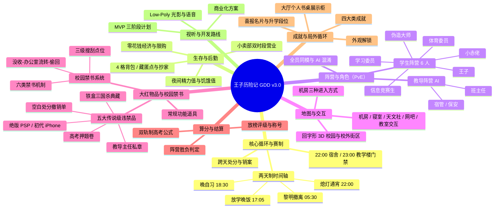
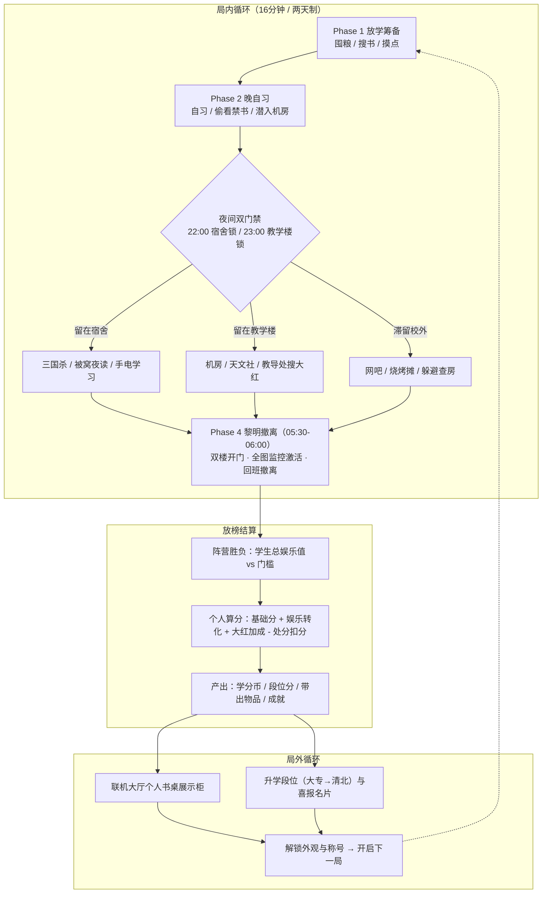

# 《王子历险记》游戏策划案（GDD v3.0）

[TOC]

---

## 一、 项目概述

| 项目 | 设定 |
| :--- | :--- |
| 游戏名称 | 《王子历险记》（暂定） |
| 游戏类型 | 3D 第一人称 PvE 校园潜行“搜打撤”（玩家扮演学生，对抗 AI 教导阵营） |
| 美术风格 | 3D 低多边形（Low-Poly）+ 物理布娃娃（Ragdoll） |
| 单局人数 | PvE：学生玩家 1 人（数据与规则按最多 6 人设计，预留好友合作）vs AI 教导阵营（班主任、宿管）+ 15~20 名同模型 AI 学生 |
| 单局时长 | 16 分钟（两天制，每天 8 分钟） |
| 目标平台 | PC（Steam 买断制，单人优先，后续视情况加入好友合作与移动端） |

**核心玩法概述**：
* 背景为中式寄宿高中。学生阵营在两天昼夜循环内通过违规娱乐、搜刮禁书与高价值物品积累收益，并在每天天亮前撤回安全区；教导阵营**全部由 AI 扮演**，负责巡逻、监控、抄家与抓捕；游戏难度主要来自 AI 的感知、协同与难度分级。
* 阵营胜负取决于全体学生玩家的**总娱乐值**是否达标；学生个人排名按**基础知识值**与**娱乐值**共同换算的高考分排序。
* 局内带出的稀有物品进入大厅展示柜，结算产出的学分币、成就与升学段位构成局外长线循环。

---

## 二、 系统架构思维导图

---

## 三、 核心循环流程

---

## 四、 模块导航

| 编号 | 文档 | 内容要点 | 关联模块 |
| :---: | :--- | :--- | :--- |
| 01 | [01_核心循环与昼夜赛制](./systems/01_核心循环与昼夜赛制.md) | 四阶段时间轴、跨天处分机制、22:00 宿舍 / 23:00 教学楼双门禁 | [生存后勤](./systems/02_校园生存与后勤博弈.md)、[算分结算](./systems/06_高考算分与放榜结算.md) |
| 02 | [02_校园生存与后勤博弈](./systems/02_校园生存与后勤博弈.md) | 精力/饥饿规则、零花钱与限购、小卖部双时段营业、4 格背包/藏匿点与抄家 | [昼夜赛制](./systems/01_核心循环与昼夜赛制.md)、[大红与禁书](./systems/05_传说大红与校园禁书.md) |
| 03 | [03_阵营与角色设计](./systems/03_阵营与角色设计.md) | 全员同模与 AI 混淆规则、学生 6 人技能、教导阵营 AI 行为与难度 | [地图交互](./systems/04_地图场景与违规交互.md)、[大红与禁书](./systems/05_传说大红与校园禁书.md) |
| 04 | [04_地图场景与违规交互](./systems/04_地图场景与违规交互.md) | 校园空间结构、机房三种潜入方式、各场景违规交互 | [阵营角色](./systems/03_阵营与角色设计.md)、[大红与禁书](./systems/05_传说大红与校园禁书.md) |
| 05 | [05_传说大红与校园禁书](./systems/05_传说大红与校园禁书.md) | 五大传说级违禁品、禁书搜刮与阅读、没收反偷闭环、功能道具 | [生存后勤](./systems/02_校园生存与后勤博弈.md)、[成就与局外](./systems/07_成就系统与局外循环.md) |
| 06 | [06_高考算分与放榜结算](./systems/06_高考算分与放榜结算.md) | 阵营胜负条件、双轨制算分公式、大红加分、评级称号 | [昼夜赛制](./systems/01_核心循环与昼夜赛制.md)、[成就与局外](./systems/07_成就系统与局外循环.md) |
| 07 | [07_成就系统与局外循环](./systems/07_成就系统与局外循环.md) | 四大类成就列表、大厅 3D 展示柜、喜报名片、升学段位与外观 | [大红与禁书](./systems/05_传说大红与校园禁书.md)、[算分结算](./systems/06_高考算分与放榜结算.md) |
| 08 | [08_视听规范与开发路线](./systems/08_视听规范与开发路线.md) | 美术与光影规范、音效与 3D 语音、商业化、MVP 三阶段计划 | 全部模块 |

---

## 五、 版本记录

* **v2.0**：确立 2v6 两天制、生存囤粮抄家、全员同模混淆、扫帚杆开门、双轨制高考结算。
* **v2.1**：明确阵营胜负按全体学生娱乐值总和判定（`ENT_GOAL_PER_STUDENT`），个人排名按高考分判定。
* **v3.0**：拆分为模块化知识库；补充五大传说级违禁品、校园禁书搜刮与没收反偷闭环、成就系统、大厅展示柜与升学段位。
* **v3.1**：玩法改为 **PvE**：教导阵营不再由玩家操控，改为 AI（班主任、宿管），原技能转为 AI 行为；新增难度分级。阵营胜负规则不变（学生娱乐值总和达标 = 挑战成功）。