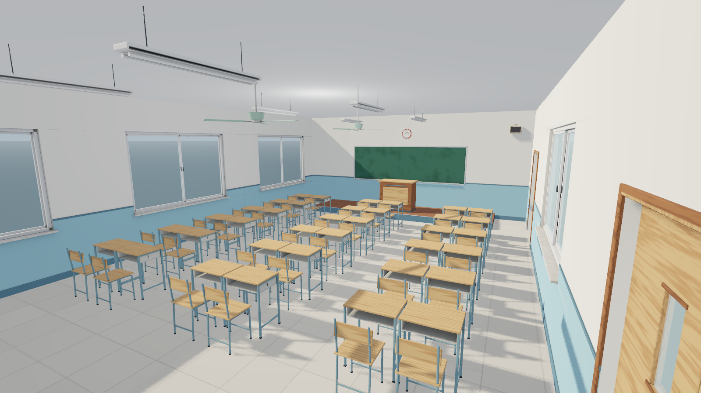

[返回总览](../GDD_策划案.md) | 配套：[01_开发任务拆分](./01_开发任务拆分.md) · [03_玩法原型拆分](./03_玩法原型拆分.md)

# 02. 美术资源清单（交美术）

> 适用版本：GDD v3.1（PvE）。风格：**3D 卡通（Q 版大头角色 + 简化写实道具，平涂色贴图 + AO）**，中式寄宿高中。风格依据见 1.4。
> 优先级：**P0** = M1 核心白盒必需（可先交灰模 / 简模），**P1** = M2 完整校园，**P2** = M3 打磨与局外。
> 音频素材清单在文末附录，交音频同学。

[TOC]

---

## 一、 制作与交付规范（所有资源通用）

### 1.1 技术规格

| 项目 | 规范 |
| :--- | :--- |
| **单位与尺度** | 1 单位 = 1 米，**导出前统一成米**（不要厘米）。学生总高约 1.60~1.70 m、老师约 1.75 m（头部放大，身高不缩）；门高 2.2 m、门宽 ≥ 1.6 m（导航需要）、层高 3.4 m；家具按真实尺寸（课桌面高约 0.75 m）。 |
| **坐标与朝向** | Y 轴向上；角色与道具**面朝 -Z**；角色枢轴在**两脚中间的地面**，道具枢轴在底面中心。 |
| **面数预算**（三角面） | 学生 10000~15000，另交 LOD1 约 4000；老师 / NPC 10000~12000；头发独立网格（换装用）。手持道具 100~1000；场景小件 ≤ 500；家具 300~1800；一间房的家具整套 ≤ 15000；室内墙 / 地 / 门窗模块每块 ≤ 1500；远景建筑每栋 900~3500。 |
| **贴图** | **平涂色块为主**：底色贴图（大色块 + 少量线条细节，如五官、校服条纹、木纹）+ 一张 AO 贴图（体积感靠 AO，不画光影、不做法线贴图，确有需要的除外）。分辨率：角色 2048²（脸、身体可分开）、家具 / 大件 1024²、小件 512² 或 256²，同类小件合并图集。需要图案的（书封、海报、卡牌、屏幕）单独贴图 ≤ 1024²。全部 PNG。 |
| **材质** | 一律 `roughness = 1`、`metallic = 0`（金属件也用颜色表现）；每个模型材质数 ≤ 4（角色 ≤ 6）。描边、边缘光由引擎着色器统一做，模型不用自带。 |
| **格式** | 模型 `.glb`（含骨骼、动画、材质）；贴图 `.png`；UI 位图 `.png`（矢量图可交 `.svg`）。 |
| **碰撞** | 需要挡人的模型附带简化碰撞网格，节点名加 `-col` 后缀（Godot 导入时自动生成碰撞）；小道具不需要。 |
| **骨骼** | 学生与所有成年 NPC 使用**同一套人形骨骼**（命名统一），以便共用动画；骨骼命名表由程序在 PL-13 提供。 |
| **动画** | 30 fps；原地动画（不带位移，Root Motion 关闭）；每个动作单独一个动画片段，命名见各表。 |
| **第一人称手臂** | 单独一套手臂模型 + 骨骼，镜头空间制作，手持物挂点 `hand_r_socket` / `hand_l_socket`。 |
| **光照** | 底色贴图里不要画光影（AO 单独一张），光照由引擎实时 / 烘焙完成；白天明亮柔和、阴影偏浅，夜晚靠手电、屏幕等光源。 |

### 1.2 目录、命名与“地址”

资源放进项目后由程序按地址调用，**地址 = `assets/` 下的路径去掉扩展名**。替换美术时只要同名覆盖，代码不用改。

| 类别 | 目录 | 示例文件 | 对应地址 |
| :--- | :--- | :--- | :--- |
| 角色 | `assets/characters/` | `student.glb` | `characters/student` |
| 角色动画库 | `assets/animations/` | `student_anims.glb` | `animations/student_anims` |
| 第一人称 | `assets/fp/` | `fp_arms.glb` | `fp/fp_arms` |
| 道具 | `assets/props/<类>/` | `props/food/bread.glb` | `props/food/bread` |
| 场景模块 | `assets/env/<区域>/` | `env/teaching/wall_window.glb` | `env/teaching/wall_window` |
| 特效 | `assets/fx/` | `fx/chalk_dust.tscn` | `fx/chalk_dust` |
| UI 位图 | `assets/ui/<类>/` | `ui/icons/item_bread.png` | `ui/icons/item_bread` |

* 文件名用**小写英文 + 下划线**，不要用中文、空格。
* 同一目录下不要出现同名不同扩展名的文件（会冲突）。
* 交付后跑一次 `tools/build_manifest.gd` 和 `tools/test.sh`，校验通过才算入库。

### 1.3 版权提醒（重要）

GDD 中出现的真实作品与商标**不能直接使用其名称、封面或美术**，统一做**原创仿制**（谐音、虚构书名、原创卡面）：

| GDD 中的写法 | 风险 | 美术处理 |
| :--- | :--- | :--- |
| 《三国杀》卡牌与铁盒 | 游卡商标与卡面美术 | 原创“三国题材桌游”，自拟名称与卡面 |
| 《三体》《龙族》 | 小说版权与封面 | 虚构书名（科幻 / 青春幻想风格），原创封面 |
| 《知音漫客》 | 刊物商标 | 虚构漫画杂志名与封面 |
| 《五年高考三年模拟》（五三） | 商标与封面 | 原创“教辅题库”封面，可保留“五三”式绿色风格 |
| PSP / 初代 iPhone / 诺基亚 / 红牛 | 商标与外观 | 外观致敬但去掉商标，换虚构品牌名 |
| Windows 界面 | 商标与图标 | 原创“复古电脑系统”风格界面 |

### 1.4 风格对标（参考素材只看不用）

我们对标的是一款已上架的中式校园卡通游戏的**质量档次与技术规格**（上面 1.1 的面数、贴图、材质就是按它实测后定的）。它的解包素材在制作人本机（`~/Downloads/export_assets`），**只能打开看，不能导入项目、不能提交、不能截图入库、不能在它的模型或贴图上改**。

| 看什么（可以学） | 不能做（侵权） |
| :--- | :--- |
| 面数、贴图分辨率、材质数、单位尺度 | 导入或改它的模型、贴图、动画 |
| 平涂色 + AO 的上色方法、明亮柔和的打光 | 照着它的角色画：脸型、发型、眼镜、配色组合要全部原创 |
| 课桌椅、铁皮柜、上下铺、机房隔板这类**现实中国学校物件**的尺寸与拆件方式 | 照抄它的房间整体布置、Logo、海报、UI |
| 房间的组织方式：墙地门窗做模块，家具按房间做成整套（考场、机房、宿舍各一套） | 使用它的字体（方正字体需单独授权）、音效与音乐 |

**样例套件（已入库，原创）**：按上面的规格用 Blender 脚本做了一套教室资源，美术可以拿来对照尺度和上色，也可以直接当 P0 占位。共 16 件：课桌、椅子、讲台、黑板、铁皮柜、书架、挂钟、广播喇叭、日光灯、吊扇，以及直墙、带窗墙、带门洞墙、双开门、地砖、讲台地台。每件 100~1400 面，一张底色图加一张 AO 图。之后又按同一流程补了 4 件室内家具：机房电脑桌（`props/office/computer_desk`）、办公桌（`props/office/office_desk`）、宿舍上下铺（`props/dorm/bunk_bed`）、食堂连凳餐桌（`props/canteen/canteen_table`），每件 850~1500 面，校园场景里的教室、机房、办公室、寝室、食堂都用这套家具。
脚本在 `tools/blender/build_classroom_kit.py`，产物在 `assets/props/classroom/` 和 `assets/env/teaching/`；拼好的预览教室是 `scenes/dev/kit_classroom.tscn`。美术交付同名文件后，直接覆盖即可替换。

实测参考值（供美术对照）：学生约 2.3 万面（含头发，偏高，我们压到 1.5 万内）、老师约 1.1 万面、人形骨骼约 55~65 根（含手指）；课桌椅一套约 1600 面 / 1024² 贴图；单椅 700~1800 面；上下铺约 1000 面；铁皮柜约 300 面；黑板约 450 面；门约 850 面；一间考场的家具整套约 6600 面、机房约 1.5~1.9 万面、宿舍约 1.3 万面；远景楼约 900~3300 面 / 一张 1024² 贴图。

---

## 二、 角色模型（CHR）

| 编号 | 名称 | 说明与要求 | 变体 | 优先级 |
| :--- | :--- | :--- | :--- | :---: |
| CHR-01 | 学生（通用） | Q 版大头、蓝白宽大运动校服、卡通发型（头发独立网格）。**玩家与全部 AI 学生共用这一个模型**（核心玩法：同模混淆），远看必须分辨不出 | 无（外观皮肤见 SKN） | P0 |
| CHR-02 | 班主任 | 中年老师，深色夹克、眼镜，一眼能认出；需挂手电、粉笔、教鞭挂点 | — | P0 |
| CHR-03 | 宿管 / 保安大爷 | 年长、制服或军绿外套、钥匙串挂在腰上（发声道具） | — | P1 |
| CHR-04 | 老学长 NPC | 高年级学生，与 CHR-01 区分（不同校服颜色或背书包），手持钥匙 | — | P1 |
| CHR-05 | 网管 NPC | 网吧网管，坐在吧台 | — | P1 |
| CHR-06 | 烧烤摊老王 NPC | 烧烤摊老板（氛围 NPC） | — | P2 |
| CHR-07 | 第一人称手臂 | 校服袖口；挂点左右手 | — | P0 |

---

## 三、 角色动画（ANI）

### 3.1 学生（玩家第三人称外观 + AI 学生共用）

| 编号 | 动画名 | 用途 | 优先级 |
| :--- | :--- | :--- | :---: |
| ANI-S01 | `idle` | 站立待机 | P0 |
| ANI-S02 | `walk` | 正常走 | P0 |
| ANI-S03 | `walk_stiff` | **AI 僵硬步态**（玩家“模仿 AI”时也用这个，必须与 AI 完全一致） | P0 |
| ANI-S04 | `run` | 奔跑 | P0 |
| ANI-S05 | `sit_down` / `stand_up` | 坐下 / 起身过渡 | P0 |
| ANI-S06 | `sit_study` | 坐着写题 | P0 |
| ANI-S07 | `sit_sleep` | 趴桌睡觉 | P1 |
| ANI-S08 | `sit_read` | 坐着看书（含夹在课本里偷看的变体） | P1 |
| ANI-S09 | `sit_computer` | 机房 / 网吧打电脑 | P0 |
| ANI-S10 | `sit_cards` | 寝室围坐打牌 | P1 |
| ANI-S11 | `hide_cards` | 藏牌慌乱动作 | P1 |
| ANI-S12 | `eat` | 吃零食（面包 / 辣条 / 泡面） | P1 |
| ANI-S13 | `search` | 翻抽屉 / 翻柜子 | P1 |
| ANI-S14 | `climb_wall` / `vault_window` | 翻墙 / 翻窗 | P1 |
| ANI-S15 | `push` / `stumble` | 推人 / 被推踉跄（体育委员） | P1 |
| ANI-S16 | `caught` / `carried` | 被抓 / 被拎起 | P0 |
| ANI-S17 | `stand_punish` | 罚站 | P0 |
| ANI-S18 | `faint` | 睡着 / 饿晕趴地 | P1 |
| ANI-S19 | `bed_read` | 被窝里打手电看书（躺姿） | P1 |
| ANI-S20 | `bed_sleep_fake` | 装睡 | P1 |
| ANI-S21 | `whistle` | 吹口哨（体育委员） | P1 |
| ANI-S22 | `talk_pester` | 缠着老师胡说八道（小赤佬强行答疑） | P1 |
| ANI-S23 | `play_handheld` | 玩掌机（PSP 类大红） | P1 |
| ANI-S24 | `broom_poke` | 举杆从门上方伸进去（第三人称外观） | P1 |

### 3.2 老师 / NPC

| 编号 | 动画名 | 用途 | 优先级 |
| :--- | :--- | :--- | :---: |
| ANI-T01 | `idle` / `walk` / `run` | 基础移动 | P0 |
| ANI-T02 | `look_around` | 巡逻站岗张望 | P0 |
| ANI-T03 | `stare` | 起疑凝视（身体前倾） | P0 |
| ANI-T04 | `peek_door` | 后门凝视：贴门窗往里看 | P0 |
| ANI-T05 | `grab` / `carry` | 抓人 / 拎着学生走 | P0 |
| ANI-T06 | `throw_chalk` | 粉笔头狙击 | P1 |
| ANI-T07 | `kick_door` | 宿管踹门 | P1 |
| ANI-T08 | `search_container` | 抄家翻柜子 | P1 |
| ANI-T09 | `stunned` | 硬直：致盲（捂眼）、精神冲击、降维打击 | P1 |
| ANI-T10 | `listen_confused` | 被强行答疑缠住（被迫听讲） | P1 |
| ANI-T11 | `guilty` | 误抓 AI 学生后的愧疚 | P1 |
| ANI-T12 | `ride_ebike` | 骑电瓶车 | P1 |
| ANI-T13 | `sit_monitor` | 监控室盯屏幕 | P1 |
| ANI-T14 | `check_note` | 保安核验请假条 | P1 |
| ANI-N01 | 老学长：`walk_key` / `open_door` | 拿钥匙开机房门 | P1 |
| ANI-N02 | 网管：`sit_counter` / `shout` | 吧台坐着 / 喊“查房了！” | P1 |

### 3.3 第一人称手臂

| 编号 | 动画名 | 用途 | 优先级 |
| :--- | :--- | :--- | :---: |
| ANI-F01 | `fp_idle` / `fp_walk` / `fp_run` | 空手基础 | P0 |
| ANI-F02 | `fp_flashlight` | 拿手电 | P0 |
| ANI-F03 | `fp_broom_hold` / `fp_broom_poke` | 握扫帚杆、伸杆微操 | P0 |
| ANI-F04 | `fp_book_read` / `fp_book_close` | 捧书阅读 / 合书 | P1 |
| ANI-F05 | `fp_eat` | 吃东西 | P1 |
| ANI-F06 | `fp_cards` | 拿手牌、出牌、藏牌 | P1 |
| ANI-F07 | `fp_handheld` | 双手握掌机 | P1 |
| ANI-F08 | `fp_write` | 写字（伪造签名） | P1 |
| ANI-F09 | `fp_search` | 翻找 | P1 |

---

## 四、 场景模块（ENV）

模块化制作，按区域分包。白盒尺寸以 [01_开发任务拆分](./01_开发任务拆分.md) 的 LV 任务为准。

### 4.1 教学楼（ENV-T）

| 编号 | 名称 | 说明 | 优先级 |
| :--- | :--- | :--- | :---: |
| ENV-T01 | 墙体模块 | 直墙、带窗墙、带门墙、转角；浅蓝墙裙 + 白墙 | P0 |
| ENV-T02 | 教室门 | 前门 / 后门（后门带小窗，供后门凝视）、门牌 | P0 |
| ENV-T03 | 机房门 | **门上方带防盗网格气窗**（撬门玩法关键）、门内压柄把手 | P0 |
| ENV-T04 | 外廊 | 栏杆、立柱、廊顶、地砖 | P0 |
| ENV-T05 | 楼梯间 | 楼梯、扶手、楼层标识 | P1 |
| ENV-T06 | 教学楼外立面 | 三层立面、楼名、横幅挂点（“拼搏一百天”等） | P1 |
| ENV-T07 | 楼梯口门 | 可上锁的楼梯间门（23:00 门禁锁的是楼梯口） | P1 |
| ENV-T08 | 卫生间 | 隔间、洗手台 | P2 |

### 4.2 室内房间（ENV-R）

| 编号 | 名称 | 内容 | 优先级 |
| :--- | :--- | :--- | :---: |
| ENV-R01 | 教室 | 单人课桌（带抽屉，可搜刮）、椅子、讲台、黑板、黑板报、挂钟、吊扇、广播喇叭、后排书架 / 图书角 | P0 |
| ENV-R02 | 机房 | 电脑桌、显示器（复古 CRT 风）、主机箱（藏匿点）、机房大灯开关、空调 | P0 |
| ENV-R03 | 班主任办公室 | 办公桌（抽屉可搜刮）、椅子、作业堆、**没收柜**、处分档案柜 | P0 |
| ENV-R04 | 教导处 | **保险柜**、没收物品室、办公桌 | P1 |
| ENV-R05 | 档案室 / 校长室 | 档案架、校长桌（撤销单刷新点） | P1 |
| ENV-R06 | 天文社暗室 | 2 台电脑、凳子、讲台（暗格）、望远镜、星图海报、遮光窗帘 | P1 |
| ENV-R07 | 宿舍寝室 | 上下铺（带被子，可钻被窝）、衣柜（藏匿点）、书桌、脸盆、晾衣绳 | P1 |
| ENV-R08 | 宿管值班室 | 值班桌、钥匙板、暗格（铁盒桌游刷新点） | P1 |
| ENV-R09 | 监控室 | 8 分屏监控墙、操作台、椅子 | P1 |
| ENV-R10 | 小卖部内景 | 柜台、货架、冰柜、收银机、价目表 | P1 |
| ENV-R11 | 飞宇网吧内景 | 吧台、电脑隔间、电竞椅、后门、厕所（窗户可翻出） | P1 |
| ENV-R12 | 大厅 / 个人书桌（局外） | 3D 宿舍 / 教室风格大厅、个人课桌、铁皮展示柜 | P2 |

### 4.3 校园与校外（ENV-O）

| 编号 | 名称 | 内容 | 优先级 |
| :--- | :--- | :--- | :---: |
| ENV-O01 | 宿舍楼外观 | 多层宿舍楼、阳台、铁门（22:00 锁）、楼顶 | P1 |
| ENV-O02 | 操场 | 红色跑道、足球门、篮球架、升旗台、主席台 | P1 |
| ENV-O03 | 围墙与翻墙点 | 砖墙模块、可翻越的矮墙段 / 缺口、墙头碎玻璃（装饰） | P1 |
| ENV-O04 | 校门 | 校名门楼、电动伸缩门、保安亭（核验窗口） | P1 |
| ENV-O05 | 小卖部外观 | 小平房、雨棚、招牌 | P1 |
| ENV-O06 | 校园道路与绿化 | 林荫道、树、灌木、路灯、宣传栏 / 光荣榜、饮水机、消防栓（藏匿点） | P1 |
| ENV-O07 | 监控摄像头 | 壁挂摄像头（8 个点位共用），带指示灯 | P1 |
| ENV-O08 | 校外商业街 | 小巷、店铺立面、电线杆、垃圾桶、电瓶车 | P1 |
| ENV-O09 | 飞宇网吧外观 | 门头招牌（霓虹）、后门 | P1 |
| ENV-O10 | 老王烧烤摊 | 烤架（带烟火特效挂点）、折叠桌椅、遮阳棚 | P2 |
| ENV-O11 | 远景与天空 | 城市远景楼群、天空盒（傍晚 / 夜晚 / 黎明三套） | P2 |

---

## 五、 道具（PRP）

“手持”= 需要第一人称手持版本；“世界”= 摆在场景里可拾取的版本。两者可共用一个模型。

### 5.1 消耗品与常规道具

| 编号 | 名称 | 形态 | 备注 | 优先级 |
| :--- | :--- | :--- | :--- | :---: |
| PRP-01 | 面包 | 世界 + 手持 | 袋装 | P1 |
| PRP-02 | 泡面 | 世界 + 手持 | 桶装，含泡好状态 | P1 |
| PRP-03 | 辣条 | 世界 + 手持 | 包装原创 | P1 |
| PRP-04 | 风油精 | 世界 + 手持 | 小瓶 | P1 |
| PRP-05 | 功能饮料（红牛类） | 世界 + 手持 | 去商标的金色罐 | P1 |
| PRP-06 | 降噪耳机 | 世界 + 戴在头上 | 头戴式 | P1 |
| PRP-07 | 红蓝圆珠笔 | 世界 + 手持 | — | P1 |
| PRP-08 | 空白假条 / 填好的假条 | 世界 + 手持 | 两种状态贴图 | P1 |
| PRP-09 | 扫帚杆 + 饮料瓶 | 世界 + 手持 | **长柄**，杆头套塑料瓶；物理开锁核心道具 | P0 |
| PRP-10 | 黑板擦 | 世界 + 放门框 | 陷阱状态 | P1 |
| PRP-11 | 手电筒 | 手持 | 小型 | P0 |
| PRP-12 | 普通扑克 / 桌游卡牌 | 世界 + 手持 | 牌堆、手牌 | P1 |
| PRP-13 | 钥匙 / 钥匙串 | 世界 + 手持 | 机房钥匙、天文社钥匙（不同颜色） | P1 |
| PRP-14 | 零钱 | 世界 | 纸币 / 硬币小堆 | P1 |
| PRP-15 | 考试卷 | 世界 + 手持 | 小赤佬偷出的考试卷 | P1 |
| PRP-16 | 处分档案 | 世界 | 牛皮纸档案袋 | P1 |
| PRP-17 | 粉笔头 / 教鞭 | 老师手持 | 粉笔头为投掷物 | P1 |
| PRP-18 | 罚站柱 | 世界 | 走廊罚站标记 | P1 |
| PRP-19 | 电瓶车 | 世界（可骑） | 班主任查房用 | P1 |

### 5.2 传说级违禁品“大红”（拾取有金红光效）

| 编号 | 名称 | 说明 | 优先级 |
| :--- | :--- | :--- | :---: |
| PRP-R01 | 绝密·高考命题组押题卷 | 带“绝密”封条的试卷袋 | P1 |
| PRP-R02 | 教导主任的“真·私章” | 印章 + 印泥盒 | P1 |
| PRP-R03 | 绝版掌机 / 初代智能手机 | 两个外观（去商标）；屏幕自发光 | P1 |
| PRP-R04 | 绝版铁盒桌游·全神将典藏 | 铁盒（原创三国题材），**占 2 格**的大件 | P1 |
| PRP-R05 | 空白处分撤销单 | 红头文件样式单据 | P1 |

### 5.3 校园禁书（每本需：世界模型 + 手持阅读版 + 封面贴图 + 内页贴图）

| 编号 | 类型 | 封面要求（原创） | 品质色 | 优先级 |
| :--- | :--- | :--- | :---: | :---: |
| PRP-B01 | 言情口袋书 | 霸总风小开本 | 绿 | P1 |
| PRP-B02 | 漫画杂志 | 虚构漫画周刊，可**夹进教辅**的薄本 | 绿 | P1 |
| PRP-B03 | 硬核科幻小说 | 虚构科幻书名，深色宇宙封面 | 蓝 | P1 |
| PRP-B04 | 青春幻想小说 | 虚构书名，龙 / 学院风格 | 紫 | P1 |
| PRP-B05 | 同人手抄本 / 同人志 | 手写体、手工装订感 | 紫 | P1 |
| PRP-B06 | 厚重伪装封面小说（大红） | 外面包着“正经书”书皮的厚书 | 红 | P1 |
| PRP-B07 | 教辅题库（“五三”类） | 原创绿色教辅封面；用作伪装与大厅摆件 | — | P1 |

---

## 六、 特效（FX）

| 编号 | 名称 | 用途 | 优先级 |
| :--- | :--- | :--- | :---: |
| FX-01 | 手电体积光 | 老师 / 玩家手电光锥（夜晚核心视觉） | P0 |
| FX-02 | 屏幕光 | 电脑 / 掌机屏幕向外的蓝光 | P0 |
| FX-03 | 被窝光晕 | 被子里透出的暖光（宿管巡逻能看到） | P1 |
| FX-04 | 大红拾取光效 | 金红色光柱 + 粒子 | P1 |
| FX-05 | 粉笔灰致盲 | 黑板擦砸头、粉笔命中的灰尘爆开 | P1 |
| FX-06 | 粉笔头拖尾 | 投掷轨迹 | P1 |
| FX-07 | 头顶状态标记 | 老师头顶“?”（起疑）、“!”（发现）、搜索中 | P0 |
| FX-08 | 睡着 Zzz | 趴桌 / 饿晕时的呼噜符号 | P1 |
| FX-09 | 翻找灰尘 | 搜刮容器时的小粒子 | P2 |
| FX-10 | 踹门冲击 | 门板震动 + 灰尘 | P1 |
| FX-11 | 全图红光警报 | 屏幕边缘与场景红光闪烁（Day 2 离座警报） | P1 |
| FX-12 | 烧烤烟火 | 烧烤摊烟雾与火光 | P2 |
| FX-13 | 吃辣条 / 怪笑的声波示意 | 噪声扩散的圆圈（可选，用于提示玩家自己暴露了） | P2 |

---

## 七、 界面美术（UIA）

### 7.1 通用与 HUD

| 编号 | 名称 | 规格与说明 | 优先级 |
| :--- | :--- | :--- | :---: |
| UIA-01 | 游戏 Logo | 《王子历险记》，中文主标题 + 英文副标题，透明底 PNG + 矢量 | P1 |
| UIA-02 | 主菜单背景 | 1920×1080，傍晚校园插画 | P1 |
| UIA-03 | 加载插画 | 1920×1080 × 4~6 张（教室、机房、宿舍、操场夜景…） | P2 |
| UIA-04 | 按钮 / 面板九宫格 | 主按钮、次按钮、面板、输入框、下拉框（可沿用作业本 / 教辅风格） | P1 |
| UIA-05 | 状态图标 | 知识值、娱乐值、处分、零花钱、精力、饥饿、时钟 / 阶段（傍晚、晚自习、熄灯、黎明） | P0 |
| UIA-06 | 背包格 | 空格、选中、堆叠数字底 | P1 |
| UIA-07 | 按键提示图标 | 键盘按键帽（E、Q、F、Shift、空格、鼠标左右键…）、手柄按键（预留） | P1 |
| UIA-08 | 警觉指示器 | 屏幕边缘方向箭头 / 眼睛图标，三档颜色 | P0 |
| UIA-09 | 交互进度圈 | 翻找、撬门、伪造时的圆形进度 | P1 |
| UIA-10 | 全校广播字幕条 | 喇叭图标 + 字幕底条（带电流故障感） | P1 |
| UIA-11 | 年级群聊天弹窗 | 仿聊天软件的群消息气泡、截图缩略图框（原创 UI，不用微信商标） | P1 |
| UIA-12 | 技能图标 | 6 名角色的主动 / 被动技能图标（约 14 个） | P1 |
| UIA-13 | 角色卡片 | 6 名角色选择卡（同模但用道具 / 姿势区分）、头像 | P1 |
| UIA-14 | 难度图标 | 简单 / 普通 / 困难 / 噩梦 | P1 |

### 7.2 物品图标（统一 128×128，透明底）

| 编号 | 内容 | 数量 | 优先级 |
| :--- | :--- | :---: | :---: |
| UIA-20 | 消耗品与常规道具图标（对应 PRP-01~16） | 约 16 | P1 |
| UIA-21 | 大红图标（对应 PRP-R01~R05，含掌机 / 手机两个） | 6 | P1 |
| UIA-22 | 禁书图标（对应 PRP-B01~B07） | 7 | P1 |
| UIA-23 | 品质边框（绿 / 蓝 / 紫 / 红） | 4 | P1 |

### 7.3 小游戏专用界面（细节见 [03_玩法原型拆分](./03_玩法原型拆分.md)）

| 编号 | 名称 | 说明 | 优先级 |
| :--- | :--- | :--- | :---: |
| UIA-30 | 复古电脑系统界面 | 开机画面、桌面壁纸、桌面图标（约 8 个）、开始菜单、窗口边框、任务栏、“作业”假窗口（切屏用） | P0 |
| UIA-31 | 电脑小游戏美术 | 机房内 2~3 个像素风小游戏的精灵与界面（见 MG-03） | P0 |
| UIA-32 | 网吧小游戏美术 | 街机 / MOBA 补刀小游戏的单位、塔、血条、评分（见 MG-06） | P1 |
| UIA-33 | 原创三国桌游卡牌 | 卡背 1、身份牌、武将牌约 8、基本牌（杀 / 闪 / 桃类）约 6 种、锦囊约 6 种；含 UI 牌桌 | P1 |
| UIA-34 | 假条与签名 | 请假条模板（空白 / 填好）、班主任签名样本、印章图 | P1 |
| UIA-35 | 点名答题卡 | 脑筋急转弯答题界面、模糊遮罩 | P1 |
| UIA-36 | 小卖部商店界面 | 商品卡、价格牌、限购角标 | P1 |
| UIA-37 | QTE 图形 | 按键 QTE 提示、判定区间条、成功 / 失败反馈 | P0 |
| UIA-38 | 禁书阅读界面 | 书页遮挡下 1/3 屏的第一人称书页、翻页 | P1 |

### 7.4 结算与局外

| 编号 | 名称 | 说明 | 优先级 |
| :--- | :--- | :--- | :---: |
| UIA-40 | 高考成绩查询页 | 仿官网风格的查询页面（原创校徽 / 机构名）、逐位滚动的分数字体 | P0 |
| UIA-41 | 称号徽章 | 5 档评级称号 | P1 |
| UIA-42 | 喜报边框 | 红底金字喜报框、德育处红头文件处分框、录取通知书金框 | P2 |
| UIA-43 | 段位徽章 | 大专、二本、一本、211、985、清北 | P2 |
| UIA-44 | 成就图标 | 16 个（对应 GDD 07 四大类成就） | P2 |
| UIA-45 | 学分币图标 | 货币图标 | P2 |
| UIA-46 | 全屏金光特效 | 685 分以上的放榜庆祝 | P2 |

---

## 八、 外观皮肤（SKN，局外解锁，无数值）

| 编号 | 名称 | 说明 | 优先级 |
| :--- | :--- | :--- | :---: |
| SKN-01 | 肥大蓝白运动校服 | 基础款的夸张版 | P2 |
| SKN-02 | 冬季厚羽绒服 | 穿两条裤子的臃肿感 | P2 |
| SKN-03 | 披肩外套 | 校服外套披在肩上 | P2 |
| SKN-04 | 脸部表情贴图 | 墨镜、流汗、睡眼、惊恐猫脸等 ≥ 8 张（贴在 CHR-01 脸部） | P2 |
| SKN-05 | 书桌摆件 | 教辅题库堆、老式手机、老式台灯等 ≥ 6 个（大厅书桌用） | P2 |

> 注意：外观皮肤会破坏“全员同模”，**局内是否显示外观**需策划定规则（建议局内统一校服，只在大厅与结算显示）。

---

## 附录：音频素材清单（交音频）

| 编号 | 名称 | 说明 | 优先级 |
| :--- | :--- | :--- | :---: |
| SFX-01 | 皮鞋脚步声 | 老师专属，可辨识、能听出远近（核心预警） | P0 |
| SFX-02 | 学生脚步（走 / 跑） | 多材质：地砖、水泥、宿舍地板 | P0 |
| SFX-03 | 钥匙串哗啦声 | 宿管 / 保安靠近预警 | P1 |
| SFX-04 | 踹门巨响 | 宿管查寝 | P1 |
| SFX-05 | 塑料瓶刮擦防盗网 | 撬门持续音 | P0 |
| SFX-06 | 扫帚杆掉落巨响 | 撬门失败 | P0 |
| SFX-07 | 门把手下压 / 开门 | 撬门成功 | P0 |
| SFX-08 | 键盘鼠标声、开机声 | 机房 | P0 |
| SFX-09 | 切屏提示音 | Alt+Tab 成功 | P0 |
| SFX-10 | 洗牌 / 出牌声 | 三国杀（铁盒版无洗牌声） | P1 |
| SFX-11 | 辣条咀嚼声 | 大声暴露 | P1 |
| SFX-12 | 翻书 / 合书声 | 禁书阅读 | P1 |
| SFX-13 | 怪笑 / 抽泣 / 叹气 | 禁书负面效果 | P1 |
| SFX-14 | 翻找抽屉 / 柜子 | 搜刮 | P1 |
| SFX-15 | 铁盒碰撞声 | 携带铁盒桌游奔跑 | P1 |
| SFX-16 | 鼾声 | 睡着 / 饿晕 | P1 |
| SFX-17 | 口哨 | 体育委员技能 | P1 |
| SFX-18 | 粉笔投掷 / 命中 | 班主任技能 | P1 |
| SFX-19 | 电瓶车 | 查房 | P1 |
| SFX-20 | 网管喊“查房了！” | 语音 | P1 |
| SFX-21 | 全校广播电流声 + 播报语音 | 处分通报、门禁提示（需配音） | P0 |
| SFX-22 | 打铃 | 晚自习、熄灯、早自习铃 | P0 |
| SFX-23 | 大红拾取音效 | 变调进行曲 / 心跳重音 | P1 |
| SFX-24 | 警报声 | Day 2 离座红光警报 | P1 |
| SFX-25 | UI 音效 | 点击、确认、取消、Toast、成就、放榜滚分、金光 | P1 |
| SFX-26 | 老师语音 | 发现、追捕、跟丢、抓到、被缠住的台词（若干条） | P1 |
| BGM-01 | 主菜单 | 怀旧校园 | P1 |
| BGM-02 | 傍晚 / 晚自习 | 轻快 → 压抑 | P1 |
| BGM-03 | 熄灯潜行 | 低沉悬疑 | P1 |
| BGM-04 | 追捕 | 紧张节奏 | P1 |
| BGM-05 | 黎明撤离 | 心跳加速冲刺 | P1 |
| BGM-06 | 放榜 | 激昂（高分版 / 低分版） | P1 |
| AMB-01 | 环境底噪 | 教室、走廊、宿舍、操场、网吧、夜晚虫鸣 | P1 |

---

[返回总览](../GDD_策划案.md) | 配套：[01_开发任务拆分](./01_开发任务拆分.md) · [03_玩法原型拆分](./03_玩法原型拆分.md)
