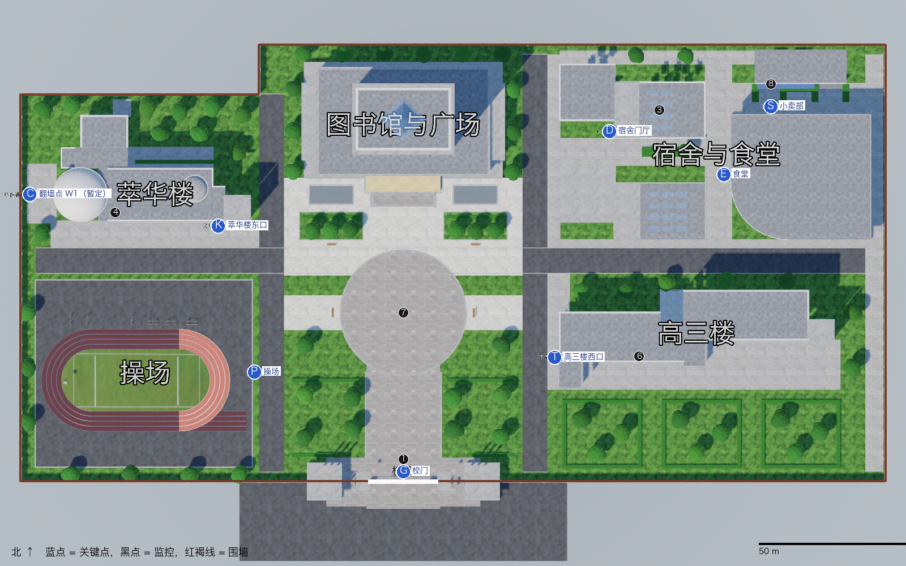

[返回总览](../GDD_策划案.md) | 配套：[01_开发任务拆分](./01_开发任务拆分.md) · [02_美术资源清单](./02_美术资源清单.md) · [05_建筑逐层横截面图](./05_建筑逐层横截面图.md) · 系统设计：[04_地图场景与违规交互](../systems/04_地图场景与违规交互.md)

# 04. 地图场景编辑计划

> 状态：**决策稿 v4.3（结构化重做 + 删庭院全图紧凑化 + 逐层截面精修版）**。
> 废除旧版从 Minecraft 体素数据直接导出的做法，改为**纯游戏坐标（米）参数化结构重建**，并已按逐层截面图与实机审阅完成全部修正：删除中式庭院，大幅压缩全校各栋建筑之间的间隙与四周留白，将整个园区收紧至 **`174 × 88 m`**（面积较 v4.1 压缩超过一半）；修复东西向楼梯护栏与所有外墙层间/拼接缝隙；东端楼梯朝外三面改为通高全玻璃幕墙；宿舍 1F 改为全墙围合门厅专属 L 梯（只到 2F）配 1F~3F 南北主梯；高三楼与萃华楼 1F 各楼梯口统一安装两侧无导轨、半升起的镂空铁链卷帘门。

[TOC]

---

## 一、 核心改版决策（v3.2 → v4.3）

| # | 调整项 | v4.3 决策方案 | 解决的问题 |
| :--- | :--- | :--- | :--- |
| 1 | **删庭院 + 全校紧凑化收紧** | 删除原庭院（`garden`），将全校外包从 `220 × 156 m` 大幅收紧为 **`174 × 88 m`**：压缩进校大道（仅 `21.5 m`）、中心广场（`R = 12.5 m`）、宿舍南北楼间距（`5.6 m`）、宿舍与食堂间距（`5.3 m`）、小卖部与食堂间距及各栋楼边缘留白，主干道统一缩为 `5 m` 宽。 | 消除各建筑之间过大空旷感，一眼望见周边地标，跑图紧凑爽快。 |
| 2 | **全图零缝隙拼接与楼梯修复** | ① 修复东西向双跑楼梯半层休息平台栏杆横挡通道的问题（仅保留两跑间 `0.16 m` 井道窄缝短栏）；② 全部建筑外墙改为层对层全高（`3.40 m`）连续生成，东楼梯西口嵌入主体立柱，严密封死萃华楼 `2.5F` 错层厕顶与 `3F` 西楼梯顶盖天花板。 | 彻底消除东楼梯每层间 `0.22 m` 水平裂缝、主体拼接缝及萃华楼西楼梯顶漏天问题。 |
| 3 | **高三教学楼** | 精简为 **3 层**：西端阅览空间（沙发+东书架+西公告栏）→ 办公室 → 东黑板教室 → 错位连廊拐角 → 中楼梯 → 办公室 → 东黑板教室 → 厕所 → **三面全玻璃外挑东楼梯**；**1F 三个楼梯口（西梯、中梯、东梯）均装两侧无导轨、半升起的镂空铁链卷帘门**（2F/3F 梯口全敞开无门）。 | 还原 1F 楼梯口锁楼机制与朝外通高全玻璃东楼梯外观。 |
| 4 | **萃华楼** | 精简为 **3 层**：① 圆塔去外环阳台，1F 南半整间为天文社，3F 中段为小机房（防盗气窗铁门）；② 西北侧设东西向西楼梯与 `-0.5F / 1.5F / 2.5F` 错半层厕所，西北 2 层副楼为南黑板教室 + 1F 北敞开台阶口；③ 去掉原东北角楼梯间，在办公室东侧设**东过道（南接 K 点）+ 平移对准走廊的三面全玻璃外挑东楼梯**；④ **1F 西楼梯口与 1F 东楼梯口安装无导轨半升起镂空铁链卷帘门**。 | 解决东楼梯偏北不顺、外墙非全玻璃及卷帘门位置问题。 |
| 5 | **宿舍楼** | **底楼 1 层 + 上面 2 层**（北楼可进、南楼壳体）：① **1F 西门厅（D 点，装铁链卷帘门）北墙与东墙严密砌死，完全隔绝 1F 其他空间，门厅内从东侧起专属 L 形楼梯（只上到 2F 就结束）**；② 紧邻中央大厅西侧设 **1F ~ 3F 贯通的南北朝向双跑主楼梯**（连接 1F 监控室/值班室、2F 与 3F）；③ 2F 门厅南半挑空，3F 封板设为自习室；2F~3F 紧凑寝室去掉书桌仅放上下铺床。 | 精确还原宿舍 1F 独立围合上二楼动线与 1F~3F 南北主楼梯分工。 |
| 6 | **校门、广场、操场、食堂、小卖部** | 南校门中间 14 m 铁门常闭 + 对称双保安室 + 双侧刷卡翼闸 + 14 m 进校大道直通圆形广场；西南操场去柱清杂；图书馆 0.52 倍精简配馆前对称真水水池花坛；2 层圆弧食堂（1F 可进）；双间连通小卖部配门前 4 段修剪绿篱夹道。 | 保持全校标志性建筑特征与干净景观。 |

---

## 二、 校园总平面（LV-02 决策稿 v4.3）



鸟瞰（`scenes/levels/campus.tscn`）：


> 游戏坐标以**米**为单位：原点 `(0, 0)` 在园区西北外包角，`x` 向东、`z` 向南、地面标高 `y = 0`。园区尺寸收紧为 **`174 × 88 m`**，共由 **6 个结构化模块**拼装而成：

| 模块 ID | 导出资源 | 平面范围 `x, z`（m） | 包含内容 |
| :--- | :--- | :--- | :--- |
| `extras` | `assets/env/campus/extras.gltf` | `0, 0 → 174, 88` | 紧凑草地基底（扣除萃华楼 `-0.5F` 下沉井）、`5 m` 宽主次干道、3 m 铁艺围墙、行道乔木与绿篱 |
| `library` | `assets/env/campus/library.gltf` | `53, 1.8 → 101, 93` | 精简图书馆、馆前对称真水水池与花坛、`R = 12.5 m` 圆形广场、短进校大道、常闭校门 + 双保安室 + 刷卡闸机 |
| `cuihua` | `assets/env/campus/cuihua.gltf` | `6.6, 13.3 → 46.4, 37.2` | 萃华楼 3 层主楼、圆塔（1F 天文社 / 3F 小机房）、西楼梯 + 错半层厕所、西北副楼、东过道 + 三面全玻璃东楼梯 |
| `gaosan` | `assets/env/campus/gaosan.gltf` | `108.2, 49.3 → 163.9, 69.2` | 高三楼 3 层（西阅览空间 + 东黑板教室 + 拐角连廊 + 两座南挑楼梯塔 + 三面全玻璃东楼梯 + 1F 三梯口卷帘门） |
| `north` | `assets/env/campus/north.gltf` | `108.2, 1.2 → 171.2, 39.4` | 紧凑生活区：宿舍北楼（1F 围合 L 梯 + 南北主梯 + 2F 挑空 + 3F 自习室 + 紧凑寝室）、宿舍南楼、2 层食堂、连通小卖部 |
| `playground` | `assets/env/campus/playground.gltf` | `3.0, 47.5 → 46.5, 85.0` | 紧凑标准塑胶跑道、足球草坪、单双杠、高音喇叭杆 |

---

## 三、 单体建筑结构与细节规范

各栋楼每层精确剖切图见配套文档 [05_建筑逐层横截面图](./05_建筑逐层横截面图.md)。

1. **高三教学楼（`gaosan`，3 层）**：
   - 每层从西到东：西阅览空间（配南挑西楼梯）→ 西办公室 → 西教室（黑板在东）→ 双跨错位连廊 → 中楼梯（配北小储藏间）→ 东办公室 → 东教室（黑板在东）→ 男女卫生间 → **对准走廊的三面全玻璃外挑东楼梯**。
   - **卷帘门**：**1F 西楼梯口、中楼梯口、东楼梯口**均装两侧无导轨、半升起的镂空铁链卷帘门（23:00 降下锁楼）；2F/3F 梯口全敞开无门。
2. **萃华楼（`cuihua`，3 层）**：
   - **西端圆塔**：1F 南半整间为天文社（钥匙门），3F 中段为小机房（防盗网格气窗铁门），北侧封闭，3F 顶盖严密封闭。
   - **西楼梯与错半层厕所**：东西朝向双跑楼梯配 `-0.5F / 1.5F / 2.5F` 错半层厕所，`2.5F` 厕顶与 `3F` 梯顶高差外墙及天花板严密闭合不漏天。
   - **东端新结构**：去掉原东北角旧梯，改为**东过道（`x: 41.6 → 44.0`，1F 南侧为东口 K 雨棚）+ 平移对准走廊的三面全玻璃外挑东楼梯（`x: 44.0 → 49.2, z: 79.4 → 84.2`）**。
   - **卷帘门**：**1F 西楼梯口（`x = 18.8`）与 1F 东楼梯口（`x = 44.0`）**安装无导轨半升起镂空铁链卷帘门（23:00 锁楼梯口后 1F 西门厅仍可进入 1F 天文社）。
3. **宿舍北楼（`north` 西半，`z: 51.2 → 66.0`）**：
   - **1F 独立围合门厅与专属 L 梯**：从西门（**D 点**，22:00 铁链卷帘门）进入后，门厅北墙与东墙严密砌死（完全看不到 1F 其他空间），沿东壁向北再折向西踏上 **L 形楼梯直达 2F 中央大厅（该楼梯只到 2F 即结束）**。
   - **1F ~ 3F 南北向主楼梯**：位于中央大厅西侧（`x: 139.2 → 143.0`），南北朝向贯通 1F（8 分屏监控室、宿管值班室）、2F 与 3F（另在最东端设 1F~3F 副楼梯）。
   - **2F 挑空 / 3F 自习室 / 紧凑寝室**：2F 门厅南侧挑空，3F 封板设为自习室；2F~3F 共 12 间紧凑寝室去掉书桌仅放两侧上下铺床。
4. **食堂与小卖部（`north` 东半，`z: 45.5 → 90.0`）**：
   - 2 层圆弧食堂（`z: 62 → 90`，1F 可进）南接东西主干道；北侧双间连通小卖部（`z: 45.5 → 52.0`）门前设 4 段修剪绿篱夹出 `4.2 m` 宽无遮挡通道。

---

## 四、 关键点、8 路监控与紧凑动线耗时

* **关键点**：**K** 萃华楼东口 `(39.8, 36.5)`，**T** 高三楼西口 `(107.5, 63.0)`，**D** 宿舍门厅 `(118.5, 17.5)`，**E** 食堂 `(141.5, 26.2)`，**S** 小卖部 `(151.0, 12.5)`，**G** 校门 `(77.0, 86.0)`，**P** 操场 `(47.0, 66.0)`，**C** 翻墙点 W1 `(1.8, 30.2)`。
* **步行与奔跑耗时（走 `3 m/s`，跑 `5 m/s`）**：
  * **T → D**（高三楼西口直上宿舍门厅）：约 **48 m**（步行 **16 s** / 奔跑 **9.5 s**）
  * **D → E**（宿舍穿 5.3 m 步道进食堂）：约 **24 m**（步行 **8 s** / 奔跑 **5 s**）
  * **T → K**（高三楼穿圆形广场去萃华楼）：约 **72 m**（步行 **24 s** / 奔跑 **14 s**）
  * **T → G**（高三楼经广场与短大道去校门）：约 **46 m**（步行 **15 s** / 奔跑 **9 s**）
  * **T → S → D → T**（教学楼 → 小卖部抢购 → 宿舍藏货 → 回教室完整一圈）：总长收紧至 **约 148 m**（步行 **49 s** / 奔跑仅需 **30 s**）！

---

## 五、 构建校验命令与实机近景

```bash
/Applications/Blender.app/Contents/MacOS/Blender -b --factory-startup --python tools/blender/build_campus_v4.py
$G --headless --path . --import
$G --headless --path . --script res://tools/build_campus.gd
$G --headless --path . --script res://tools/build_manifest.gd
python3 -I tools/map/render_floor_sections.py
tools/test.sh
```


