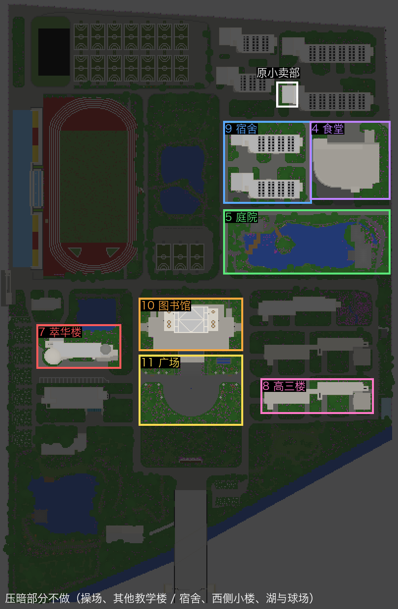
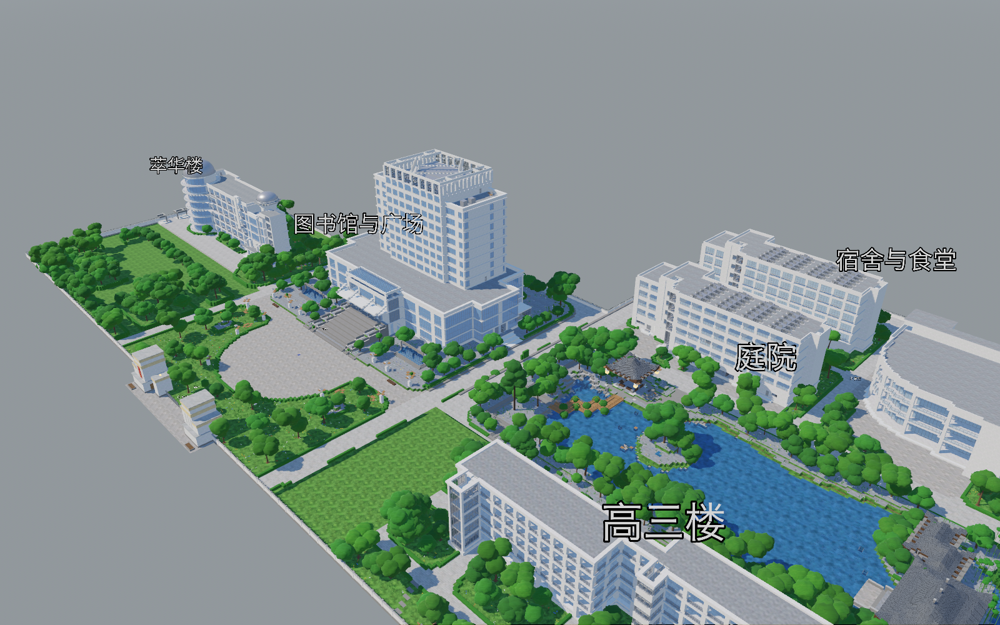
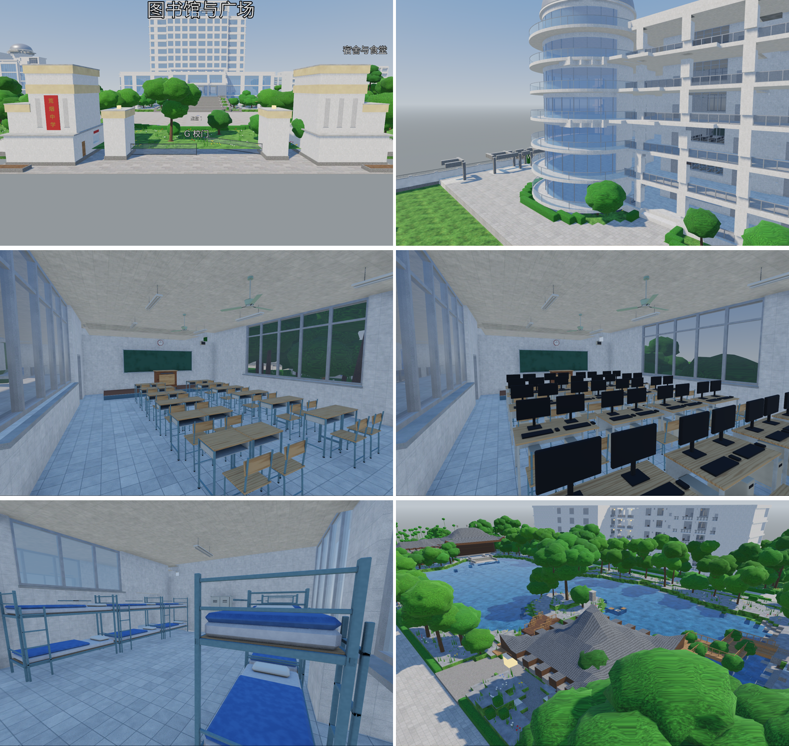

[返回总览](../GDD_策划案.md) | 配套：[01_开发任务拆分](./01_开发任务拆分.md) · [02_美术资源清单](./02_美术资源清单.md) · 系统设计：[04_地图场景与违规交互](../systems/04_地图场景与违规交互.md)

# 04. 地图场景编辑计划

> 状态：**决策稿 v3.2**。MC 只提供布局、体量和层数；墙、窗、门、栏杆、楼梯、贴图、树和绿篱都重新做，不是方块风格。室内按教室套件（`kit_classroom`）的标准摆家具。只保留策划指定的几栋楼，整块平移、紧凑编排；新加了小卖部，校门照 MC 原图的南校门做。这一版只做校内，校外以后再做。
> 楼内房间用途（哪间是机房、办公室、寝室）等策划按 MC 的房间补充后再定。步行时间按假设速度估，等 LV-24 跑测后回调（见 4.2）。

[TOC]

---

## 一、 结论（先看这里）

| # | 决策 | 理由 |
| :--- | :--- | :--- |
| 1 | **楼的模型和细节完全照 MC，层数也照 MC**：萃华楼 6 层（西端 7 层高的玻璃圆塔），高三楼 5 层，宿舍 6 层，食堂 3 层，图书馆约 14 层。 | 策划指定。 |
| 2 | **MC 只当布局和体量参考，细节全部重做**：一格厚的墙变成 0.3 m 真墙，整层楼板变成 0.4 m 薄板；玻璃变成带窗框、中梃、窗台的窗；铁栏变成扶手加立杆的栏杆；楼梯做成真踏步；圆塔、圆顶用光滑曲面。材质换成按真实尺寸平铺的高分辨率贴图。树按 MC 树干位置重新生成，绿篱修成圆角，全部落地，不粘连。 | 用 Blender 脚本读 MC 数据重建（见第五节），改了 MC 原图或参数，重跑就能更新。 |
| 3 | **只保留这几栋楼**（编号沿用 MC 参考图）：7 萃华楼、8 高三楼、9 宿舍两栋、4 食堂、10 图书馆、11 广场、5 庭院。**其余都不做**：操场和球场、其他教学楼和宿舍、西侧小楼和水塘、中部的湖。 | 策划指定。 |
| 4 | **紧凑编排 = 整块平移**：每个地块（楼连同周围的路、绿篱、树）原样搬过来，只挪位置，不改内部。最后是 L 形 410 × 233 m（西北角不在校内）。 | 保住 MC 里楼和周围环境的关系。比 MC 原来的范围小约四分之一，但比 v2 的 168 × 120 m 大很多，见 4.2 的时间问题。 |
| 5 | **萃华楼是全图最重要的楼**：3F 的教室全是机房，钥匙在 3F 最东边的办公室里；1F 西端圆厅隔成天文社和小机房。**上锁的是各层楼梯口（23:00）、小机房和天文社**。 | 故事设定，见 3.1。 |
| 6 | **广场把高三楼和萃华楼连起来**，图书馆在广场北面当地标（不可进）。 | 晚自习从教室去小机房必须穿过开阔的广场。 |
| 7 | **宿舍两栋只开北楼**；**食堂只开 1F**；**小卖部新建在食堂北侧**（一排三间单层铺面，最西一间是小卖部，门前绿篱只在小卖部门口留缺口）；**校门新建在广场正南**（门柱、门头校名、伸缩门、门卫室）。 | 原 MC 里小卖部在食堂正北那栋宿舍里，那栋不做了，所以照原来“灌木缺口进店”的格局在食堂北侧新建。MC 原图的校门在拆掉的进校大道尽头，也新建。 |
| 8 | **8 路监控**，位置见 3.6；机房门口都没有监控。萃华楼西侧（圆塔背后）、庭院里也没有，是故意留的盲区。 | 让玩家有可以规划的路线。 |

---

## 二、 输入素材

### 2.1 MC 原型学校（`~/Downloads/world`）

* Minecraft 1.15.2 超平坦世界，1 格 = 1 米。草地顶面在 MC y=4（游戏里的 0），铺装地面高 1 m，楼的 1F 地面高 2 m，层高 4 m。
* 解析工具：
  * `tools/mc/mc_scan.py`：导出体素，连同方块状态（朝向、上下半砖、门的合页等）；
  * `tools/mc/mc_render.py`：俯视图，以及任意高度的切片（想看房间就切在楼板之间，比如 y=7 / 11 / 15）。



| 编号 | 建筑 | MC 实测 |
| :--- | :--- | :--- |
| 7 | 萃华楼 | 东西向一字楼，约 80 m 长，6 层，南侧开放外廊。西端门厅接一座**直径 15 m、7 层高的玻璃圆塔**，每层有白色腰线，顶上是圆顶。东头塔楼顶上还有一个小圆顶。 |
| 8 | 高三楼 | 两段错位相接的外廊式教学楼，总长约 110 m，5 层，东头有方形楼梯间。 |
| 9 | 宿舍 ×2 | 中廊式，两栋南北平行，6 层，屋顶有太阳能板。西端是门厅和楼梯。 |
| 4 | 食堂 | 约 70 × 65 m，西南角是一段大圆弧，3 层，层高 5 m。 |
| 10 | 图书馆 | 3 层裙楼加约 14 层的主楼；正门前是大台阶，两边有水池。 |
| 11 | 广场 | 大圆形铺地，周围是草坪和树，南接校门。 |
| 5 | 庭院 | 湖、小岛、木桥、两座亭子、竹林、小路。 |

### 2.2 风格对标素材（`~/Downloads/export_assets`）

* 来源是商业游戏《Worst Class Ever》的解包，**素材本身不能进项目**。规格与用法见 [02_美术资源清单 1.4](./02_美术资源清单.md)。

---

## 三、 校园总平面（LV-02 决策稿）


鸟瞰（`scenes/levels/campus.tscn`）：



> 总平面图是场景俯视截图加标注，由 `tools/map/site_plan.py` 生成。
> 游戏坐标单位是米，x 向东、z 向南，原点在围墙外包框的西北角，地面 y=0。

整体还是三排：
* **北排**：宿舍两栋、食堂。
* **中排**：图书馆（西）、庭院（东）。
* **南排**：萃华楼、广场、高三楼。

| 地块 | MC 范围（x0, z0 → x1, z1） | 平移 | 游戏里的位置（x, z） | 说明 |
| :--- | :--- | :--- | :--- | :--- |
| 萃华楼 | 452, 441 → 562, 556 | 向西 32 m | 0, 118 → 110, 233 | 南边那栋楼拆掉、改成草地；北边水塘填平 |
| 图书馆与广场 | 562, 404 → 680, 556 | 向西 32 m | 110, 81 → 228, 233 | 原样 |
| 高三楼 | 680, 495 → 830, 556 | 不动 | 260, 172 → 410, 233 | 原样 |
| 庭院 | 648, 324 → 830, 400 | 向南 95 m | 228, 96 → 410, 172 | 原样，填进被拆掉的两栋教学楼的位置 |
| 宿舍与食堂 | 648, 228 → 830, 324 | 向南 95 m | 228, 0 → 410, 96 | 原样 |

* 图书馆东边、高三楼西边留了一条 32 m 宽的草地（x 228 → 260，z 172 → 233），是两块平移后的空隙。
* 校门在南墙广场正南（x 157 → 177）；翻墙点 W1 暂定在西墙、萃华楼圆塔背后。
* 围墙 3 m 高，L 形；校门外以后再做。

### 3.1 萃华楼（7，6 层 + 玻璃圆塔）

**故事设定**（策划给的，按 MC 的楼落位）：

* 3F 的教室全是机房；1F、2F 是教室和办公室；4F~6F 的用途待定。
* 每层最东边的房间是办公室。3F 的这间**朝外廊没有门**，跟东边第一间教室（机房）连在一起：
  * 机房东墙上靠近机房东门的位置开一扇门通办公室；
  * 一大串钥匙挂在办公室里紧挨这扇门的墙上，有各间教室的、各间机房的，还有**小机房**的。
* 1F 西端圆塔的底层是**圆厅**，平时拉着帘子，用一道直墙隔成不相通的两间：
  * **天文社**：大的一间，中间一张大桌子、两张电脑桌，钥匙在小赤佬手里（[GDD 03](../systems/03_阵营与角色设计.md)）；
  * **小机房**：竞赛生的机房，门就是 MC 里圆塔东侧那扇铁门。
* MC 的圆塔里每层都是空的，隔墙、门和家具要在玩法层补上（LV-05）。

**门锁**

* 上锁的有三处：
  * **各层楼梯口**：23:00 的教学楼门禁锁的就是楼梯口（锁楼 = 锁楼梯口），楼上的下不来，楼下的上不去，**只能等 05:30 开锁**（楼梯口门不能撬，钥匙串里也没有楼梯口钥匙）。1F 不受影响。高三楼也一样。
  * **小机房**：钥匙在 3F 钥匙办公室。
  * **天文社**：钥匙在小赤佬手里。
* 教室、3F 的机房、钥匙办公室都不锁。
* 天文社和小机房都在 1F，锁了楼梯照样能凭钥匙进。但小机房钥匙在 3F，**必须 23:00 前上楼拿下来**。

**机房与小机房**

* 3F 的大机房是上课用的，晚上没课，进去开机肯定被发现，所以**晚上不是目标**。
* **小机房**晚上唯一能玩电脑的地方。GDD 里进机房的三种办法（拿钥匙、蹭老学长、扫帚杆撬门）都用在小机房门上。

### 3.2 高三楼（8，5 层）

* 照 MC：两段错位、5 层、外廊式，东头方形楼梯间，西口（T 点）朝广场方向。
* 本班教室、班主任办公室、教导处（保险柜）、没收物品室、档案室、校长室这些 GDD 需要的房间，等策划按 MC 的房间排。

### 3.3 宿舍（9，6 层，只开北楼）

* 照 MC：中廊式，6 层，西端门厅和楼梯（D 点），屋顶太阳能板。南楼不可进。
* 寝室、值班室、监控室（8 分屏）、楼顶（大红：铁盒桌游刷新点）的位置，等策划按 MC 的房间排。开局只开放 4~6 间寝室。

### 3.4 食堂（4）与小卖部

* 食堂照 MC：西南角大圆弧，3 层，**只开 1F**，2F、3F 只看外观。
* **小卖部**（新建，游戏坐标 x 326 → 350，z 1 → 9.5）：
  * 食堂北侧一排单层铺面，背靠北围墙，共 3 间；最西一间是小卖部，另外两间是卷帘门。
  * 小卖部有玻璃橱窗、敞开的玻璃门、蓝色雨棚、红底“小卖部”招牌；里面有柜台、三排货架、冰柜。
  * 门前一排绿篱，只在小卖部门口（x 331）留缺口，是唯一的入口。

### 3.4.1 校门（照 MC 原图的南校门）

* 位置：南墙广场正南，整组宽 54 m（x 140 → 194），门洞 24 m（x 155 → 179）。
* 结构（照 MC 南校门的体量，细节重做）：
  * **两侧塔楼**：各 9 × 10 m，阶梯状；内侧高塔 13 m、外侧肩部 8 m，各有米黄色腰线，正面有竖向窄窗。
  * **门卫室**：在西塔底层，门和假条核验窗口开在朝人行侧门的一面，窗口外有台面。
  * **门柱**：3 × 5 m、7 m 高，顶部米黄腰线加一盏灯。
  * **人行侧门**：门柱和塔楼之间各 3 m，格栅小门开着。
  * **大门**：西半是推拉铁门，关着；东扇斜开 32°。
  * **校名**：竖排红底金字“荒烟中学”，挂在西塔南面（配置 `extras.gate.name`）。
* 门外两侧有花坛，门内外都铺了石材。
* 围墙也是新做的：毛石墙基、涂料墙身、混凝土压顶、每 4 m 一根壁柱，顶上一道铁艺，总高 3 m。

### 3.5 图书馆、广场、庭院

* **图书馆（10）**：不可进，约 14 层，在哪都能看到，当方向参照。正门大台阶两边有水池。
* **广场（11）**：大圆形铺地。西边是萃华楼，东边隔着草地是高三楼，南边是校门。没有遮挡，晚上穿过去最容易被看到，监控 7 对着这里。
* **庭院（5）**：湖、小岛、木桥、亭子、竹林，灌木和树能藏人；在宿舍、食堂和高三楼之间。

### 3.5.1 室内（教室套件标准）

* 重建时自动识别房间：每层楼板上方第 3 格（天花板下、家具够不到的高度）找封闭的格子。规则如下：
  * 楼梯间（高处有楼梯块）不算；
  * 不可进的楼不动：宿舍南楼、食堂 2F 以上、图书馆。
* 房间按 `room_rules` 分类：

| 类型 | 规则（按顺序匹配） | 摆什么（套件） |
| :--- | :--- | :--- |
| 食堂 | 食堂范围内、面积 ≥ 200 | 连凳餐桌成排 |
| 机房 | 萃华楼 3F、45~200 m² | 黑板、讲台、电脑桌（每张两台电脑）、钢管椅 |
| 寝室 | 宿舍北楼范围、25~120 m² | 上下铺沿两侧长墙、课桌、铁皮柜 |
| 教室 | 60~200 m²、短边 ≥ 6 m | 黑板、讲台、地台、挂钟、喇叭、两两一组的课桌椅、书柜、铁皮柜、吊扇 |
| 办公室 | 16~60 m² | 对拼的办公桌（带显示器、抽屉柜）、铁皮柜、书柜 |

* 所有分了类型的房间都装吸顶日光灯（约每 3 m 一盏）。
* 分了类型的房间会做三件事：
  * 清掉 MC 的方块家具和嵌在天花板里的灯；
  * 只有栏杆、上面敞开的边补成落地玻璃；窗户上方 MC 留的空格补成玻璃；
  * 在房间里最大的室内矩形（避开墙、窗下墙、阳台）里摆家具。
* 当前识别结果：
  * 萃华楼：教室 17、机房 3、办公室 4；
  * 高三楼：教室 10、办公室 28（策划定：小房间都当办公室）；
  * 宿舍：寝室 65、办公室 5。
  * 合计约 3600 件套件家具。
* 新做的套件（Blender，跟教室套件同一套烘焙流程）：电脑桌 `props/office/computer_desk`、办公桌 `props/office/office_desk`、上下铺 `props/dorm/bunk_bed`、食堂连凳餐桌 `props/canteen/canteen_table`。
* 天花板穿模已修：
  * 楼板层里嵌的灯、开关补成楼板，灯做成贴在板底的灯片；
  * 挂在天花板下的小件跟着薄楼板上移；
  * 树冠生成时避开墙、楼板和玻璃。

### 3.6 8 路监控（LV-18）

| # | 位置 | 看什么 |
| :--- | :--- | :--- |
| 1 | 校门 | 进出校门、假条核验 |
| 2 | 宿舍门厅 | 门禁前后进出宿舍 |
| 3 | 宿舍走廊 | 查寝路线 |
| 4 | 萃华楼门厅 | 进出萃华楼、主楼梯口 |
| 5 | 高三楼西口 | 从高三楼出来去广场的人 |
| 6 | 高三楼外廊 | 本班和教导处门口 |
| 7 | 广场 | 广场上来往的人 |
| 8 | 小卖部门口 | 囤货 |

* 坐标在 `data/map/campus_plots.json` 的 `cameras` 里，楼内的具体安装点等房间排好后再调。

---

## 四、 尺度与时间

### 4.1 尺度

| 项目 | 数值 |
| :--- | :--- |
| 比例 | 1 MC 格 = 1 m |
| 层高 | 4 m（食堂 5 m） |
| 墙厚 | 1 m（照 MC） |
| 门 | 1 × 2 m（MC 门） |
| 楼梯 | MC 楼梯，每级 0.5 m；碰撞做成连续斜坡 |
| 围墙 | 3 m |

### 4.2 关键路线步行时间（假设：走 3 m/s，跑 5 m/s；待 LV-24 跑测）

关键点（总平面上的蓝点）：K 萃华楼东口，T 高三楼西口，D 宿舍门厅，E 食堂，S 小卖部，G 校门，C 翻墙点 W1。

| 路线 | 距离 | 走 | 跑 | 用在哪 |
| :--- | ---: | ---: | ---: | :--- |
| T → K（穿广场） | 约 190 m | 63 s | 38 s | 晚自习溜去小机房 / 天文社 |
| T → D | 约 200 m | 67 s | 40 s | 晚自习后回宿舍 |
| D → E | 约 110 m | 37 s | 22 s | 去食堂 |
| T → G | 约 140 m | 47 s | 28 s | 拿假条出校 |
| D → K | 约 270 m | 90 s | 54 s | 熄灯前从宿舍去小机房 |
| T → S → D → T | 约 620 m | 206 s | 124 s | Phase 1 的典型一圈 |

* **地图按 MC 原尺寸后，Phase 1（90 s）跑不完一圈**，跑步也要 124 s。要在下面几种办法里选：
  * 移动速度调快；
  * Phase 1 加长；
  * Phase 1 的目标收窄，不要求一圈全走；
  * 把地块再往一起挤：比如庭院、宿舍和食堂再往西挪，萃华楼往东挪。
* 跑测（LV-24）后定。

---

## 五、 编辑流程

1. **MC 扫描**（只在 MC 原图改了时重做）：
   ```bash
   python3 -I tools/mc/mc_scan.py ~/Downloads/world <扫描输出目录>
   ```
2. **贴图**（只在改了贴图算法时重做）：`python3 -I tools/blender/make_textures.py`，生成 `assets/env/campus/textures/*.png`。
   * 包括外墙面砖、涂料、混凝土、铺地、广场石材、沥青、草地、泥土、碎石、木板、树皮、树叶、屋面、金属、卷帘门、水、毛石，全部四方连续。
   * 每张贴图对应的真实尺寸写在脚本里，重建时按这个尺寸算 UV。
3. **改配置（策）**：`data/map/campus_plots.json`。
   * 地块：`box` MC 范围、`offset` 平移、`strip` 拆楼留植物、`clear` 全部清空、`dry` 填水塘、`replace` 圆塔 / 圆顶。
   * `extras`：小卖部、校门（游戏坐标）、地面缺角。
   * `wall` 围墙、`points` 关键点、`cameras` 监控、`review_cameras` 评审机位。
4. **重建模型（程）**：
   ```bash
   /Applications/Blender.app/Contents/MacOS/Blender -b --factory-startup --python tools/blender/build_mc_campus.py -- <扫描输出目录> [地块 id ... | extras]
   ```
   * 每个地块导出 `assets/env/campus/<id>.gltf + .bin`，贴图引用 `textures/`（各地块共用）；新部件导出 `extras.gltf`。门的位置写到 `data/map/campus_doors.json`。
   * 建筑规则在 `tools/blender/mc_lib.py`：一格厚的墙变成 0.3 m 墙（台阶状的斜墙按对角线连）；上下悬空的整层楼板变成 0.4 m 薄板，下面的墙、窗、柱子长到板底；玻璃变成窗（窗框、中梃、窗台、高窗加横档）；铁栏、栅栏变成栏杆；楼梯每格做四级小踏步，碰撞是斜坡；顶面按露天 / 室内分屋面和地砖。
   * 植物规则也在 `mc_lib.py`：原木连通块是一棵树，树叶从各棵树同时往外分配（不会糊成一团），聚成几团树冠，离树干太远的往里收；剩下的树叶按连通块落到下面的地面或台面上，长条的做圆角绿篱，成团的做灌木，悬空的丢掉；矮草只稀疏种，花和高草照 MC 位置种。
   * 新部件在 `tools/blender/campus_extras.py`：地面、围墙、校门（照 MC 南校门）、门卫室、小卖部，文字用系统中文字体转成网格。
   * 房间识别、清家具、封窗也在这一步做，结果写到 `data/map/campus_rooms.json`（类型、范围、摆家具用的矩形、门）。
   * 坡屋顶：`roofs` 里标出范围，屋檐层以上的方块按每格顶面高度连成连续斜面。
   * 室内家具用的套件在 `tools/blender/build_classroom_kit.py` 里做（跟教室套件同一流程，有底色 + AO 烘焙）。
5. **拼场景（程）**：
   ```bash
   $G --headless --path . --import
   $G --headless --path . --script res://tools/build_campus.gd
   ```
   * 输出 `scenes/levels/campus.tscn`：地块、新部件、按房间类型摆好的套件家具（`Furniture` 节点下按房间分组）、门位（`doors` 组）、关键点（`map_points` 组）、监控（`cctv` 组）、评审机位。
   * 评审机位：OverviewCamera、TopCamera、CuihuaCamera、NorthCamera、PlazaCamera、GardenCamera、GateCamera、ShopCamera、DormCamera、ClassroomCamera、LabCamera、PavilionCamera、TowerCamera。
6. **出总平面图**：用 TopCamera 截俯视图，再跑 `python3 -I tools/map/site_plan.py <俯视截图>`。
7. **玩法层（后续）**：按房间补门锁（LV-07）、圆厅隔墙和家具（LV-05）、点位（LV-10）、导航与跑测（LV-09 / LV-24）。
8. **美术替换（LV-19 / 20）**：美术出正式模型时以这些地块为体量和细节参考，直接替换对应的 .gltf。

近景（校门、圆塔、教室、机房、寝室、庭院亭子）：



---

## 六、 还没定的（不阻塞开工）

* **Phase 1 的时间和地图尺度**（见 4.2）。
* **楼内房间用途**：萃华楼 4F~6F；高三楼、宿舍各房间；值班室和监控室在哪。
* **翻墙点 W1** 的最终位置。
* 移动速度是假设值，要和玩家移动（PL）、AI 巡逻（AI）任务一起定。
* 庭院的两座亭子已经改成连续的青瓦坡屋面（`roofs` 配置），茶室西侧的小翼屋顶还是台阶状；圆塔每层改成光滑的环形阳台加玻璃栏板，和主楼接缝处还有少量楼板头。
* 地块边缘的路面接缝，跑测时一起看。
