[返回总览](../GDD_策划案.md) | 配套：[04_地图场景编辑计划](./04_地图场景编辑计划.md) · [01_开发任务拆分](./01_开发任务拆分.md) · [02_美术资源清单](./02_美术资源清单.md)

# 05. 全校各栋建筑逐层水平横截面图（v4.2）

> 所有截面图均由 `python3 -I tools/map/render_floor_sections.py` 直接从当前场景模型（`assets/env/campus/*.gltf`）与 `data/map/campus_rooms.json`、`data/map/campus_doors.json` 实测剖切生成。

[TOC]

---

## 一、 高三教学楼（共 3 层：`G1` ~ `G3`）

### 1.1 高三教学楼 — 1F 横截面（三处楼梯口安装无导轨半升起镂空铁链卷帘门）

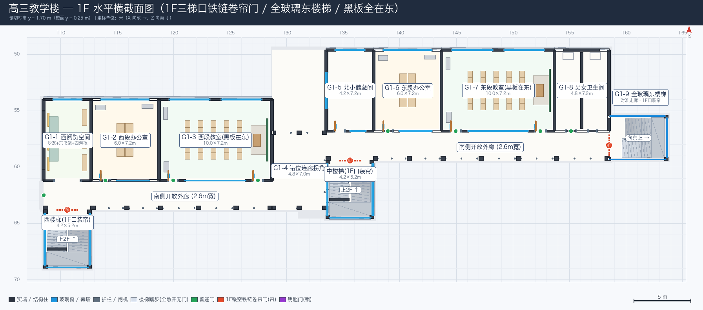

### 1.2 高三教学楼 — 2F 横截面

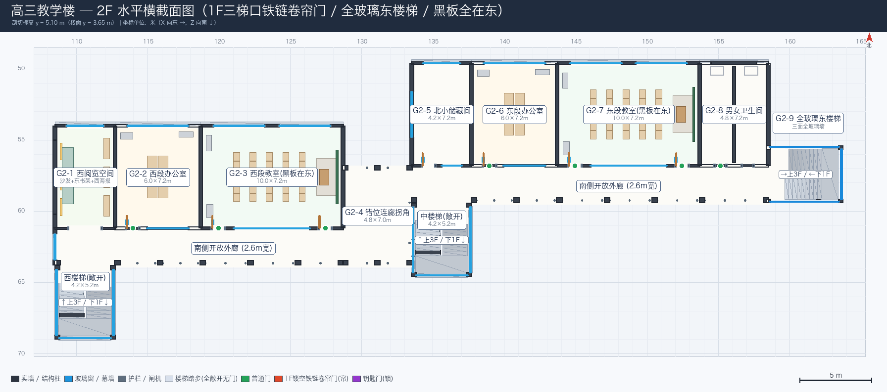

### 1.3 高三教学楼 — 3F 横截面

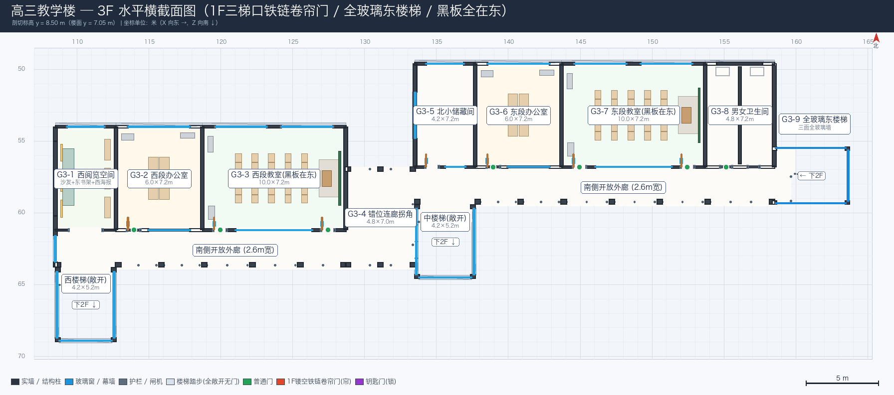

| 编号（`n` = 1/2/3 层） | 当前空间 | 净尺寸（宽 × 深） | 结构与门帘说明 |
| :--- | :--- | :--- | :--- |
| `Gn-1` + 南挑西楼梯 | 西端阅览空间 + 南挑西楼梯 | 阅览 `4.2 × 7.2 m`；梯 `4.2 × 5.2 m` | **1F 西楼梯口装无导轨半升起镂空铁链卷帘门（帘）**，2F/3F 敞开；1F 西侧为 T 点敞口 |
| `Gn-2` / `Gn-6` | 西段办公室 / 东段办公室 | 各 `6.0 × 7.2 m` | 朝南外廊单门 + 观察窗 |
| `Gn-3` / `Gn-7` | 西段教室 / 东段教室 | 各 `10.0 × 7.2 m` | **黑板均在东墙**，朝南外廊前后双门 + 观察窗 |
| `Gn-4` | 错位连廊拐角 | `4.8 × 7.0 m` | 双跨架空柱廊连通西段与东段外廊 |
| `Gn-5` + 南挑中楼梯 | 北小储藏间 + 南挑中楼梯 | 储 `4.2 × 7.2 m`；梯 `4.2 × 5.2 m` | **1F 中楼梯口装无导轨半升起镂空铁链卷帘门（帘）**，2F/3F 敞开 |
| `Gn-8` | 男女卫生间 | `4.8 × 7.2 m` | 中隔墙分男女两间，朝南外廊双门 + 北高窗 |
| `Gn-9` | **全玻璃外挑东楼梯** | `5.2 × 4.0 m` | **对准走廊，北/东/南朝外三面全玻璃幕墙（零层间与主体拼接缝隙）；1F 梯口装铁链卷帘门（帘）** |

---

## 二、 萃华楼（共 3 层：`C1` ~ `C3`）

### 2.1 萃华楼 — 1F 横截面（东过道 + 全玻璃东楼梯 + 两处 1F 梯口铁链卷帘门）

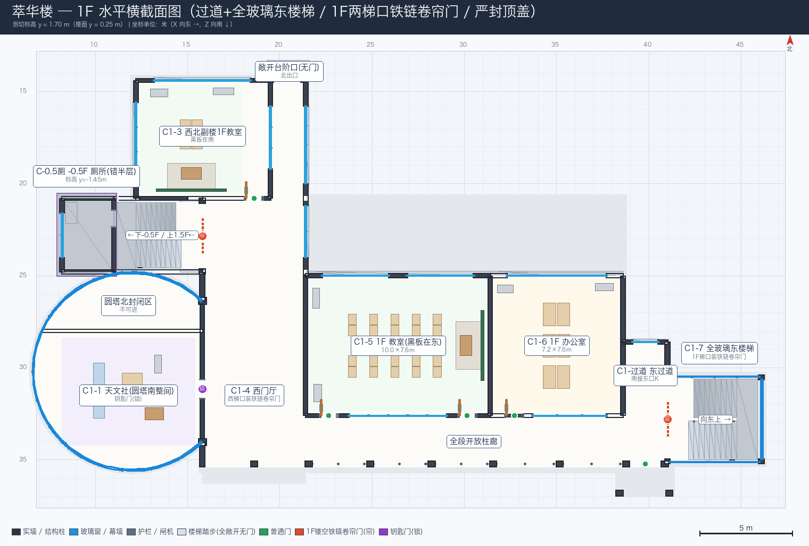

### 2.2 萃华楼 — 2F 横截面

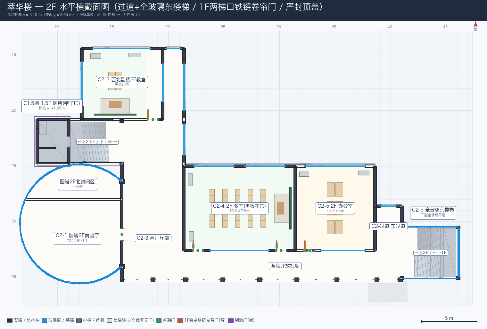

### 2.3 萃华楼 — 3F 横截面（`2.5F` 错层厕顶与 `3F` 西梯顶盖天花板已严密封闭）

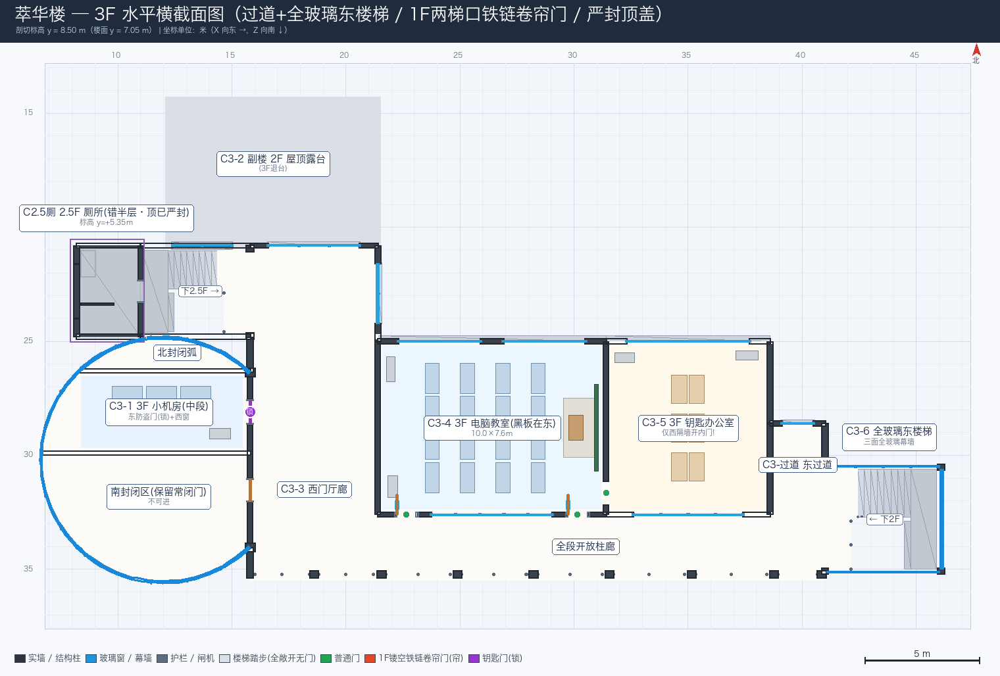

| 编号 | 楼层 | 当前空间 | 尺寸 / 标高 | 结构与门锁说明 |
| :--- | :---: | :--- | :--- | :--- |
| `C1-1` / `C2-1` | 1F / 2F | **1F 天文社** / 2F 南圆厅 | 圆塔 `R = 5.4 m`（`z > 77.0`） | 北半封闭；1F 南半整间为天文社（钥匙门【锁】），23:00 锁楼梯口后仍可从 1F 门厅进入 |
| `C3-1` | 3F | **3F 小机房（圆塔中段）** | `z: 75.3 → 78.9` | 东墙防盗网格气窗铁门（锁）+ 西窗；南段封闭保留常闭门 |
| `C-0.5厕` / `C1.5厕` / `C2.5厕` | 错半层 | 西端错半层厕所 + 东西向西楼梯 | `y = -1.45 / 1.95 / 5.35 m` | **1F 西楼梯口（`x = 18.8`）装铁链卷帘门（帘）**；`2.5F` 厕顶与 `3F` 梯顶高差墙及天花板严密封死 |
| `C1-3` / `C2-2` | 1F / 2F | 西北副楼教室（黑板在南） | 教室 `7.3 × 6.4 m` + 东廊 | 1F 东廊北端为无门敞开台阶出口；`C3-2` 为 2F 平屋顶露台 |
| `C1-5` / `C2-4` / `C3-4` | 1~3F | 标准教室 / **3F 电脑教室** | `10.0 × 7.6 m` | **黑板均在东墙**；`C3-4` 东墙南端开内门通 `C3-5` 钥匙办公室 |
| `C1-6` / `C2-5` / `C3-5` | 1~3F | 办公室 / **3F 钥匙办公室** | `7.2 × 7.6 m` | 南侧全段统一开放柱廊；`C3-5` 朝外廊不开门 |
| `Cn-过道` + `Cn-7/6` | 1~3F | **东过道 + 三面全玻璃外挑东楼梯** | 过道 `2.4 × 6.8 m`；梯 `5.2 × 4.8 m` | 去掉旧东北角，东楼梯南移对准走廊，**北/东/南三面全玻璃幕墙**；**1F 东梯口（`x = 44.0`）装铁链卷帘门（帘）** |

---

## 三、 宿舍北楼（已南移 `44 m`：`D1` 围合门厅 L 梯 + 南北主梯 + `D2` 挑空 + `D3` 自习室）

### 3.1 宿舍北楼 — 1F 横截面

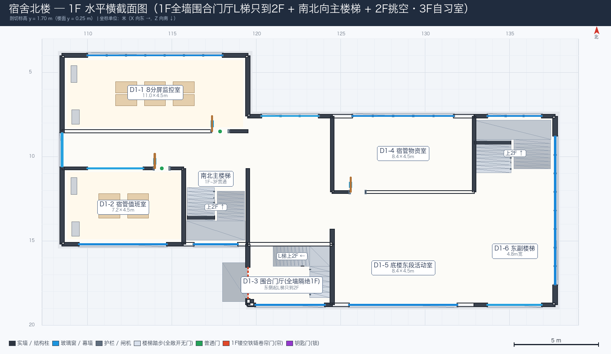

### 3.2 宿舍北楼 — 2F 横截面

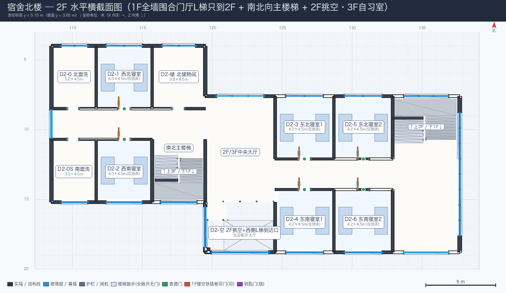

### 3.3 宿舍北楼 — 3F 横截面

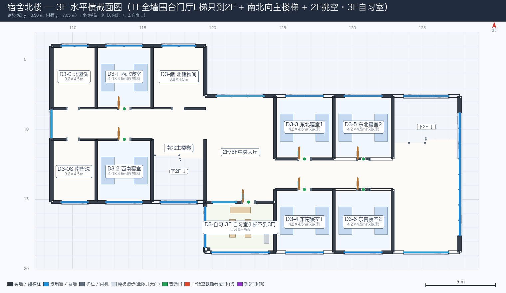

| 编号 | 楼层 | 当前空间 | 净尺寸 | 说明 |
| :--- | :---: | :--- | :--- | :--- |
| `D1-3` | 1F 底楼 | **全墙围合入口门厅 + 专属 L 梯** | `5.0 × 3.6 m` | 西口（D 点）装铁链卷帘门（帘）；**北墙与东墙严密砌死（看不到 1F 其他空间），东侧起 L 梯只上到 2F 即结束** |
| 南北主楼梯 | 1~3F | **南北朝向双跑主楼梯** | `3.8 × 4.5 m` | 位于中央大厅西侧，贯通 1F（8 分屏监控室、宿管值班室）、2F 与 3F |
| `D2-空` / `D3-自习` | 2F / 3F | 2F 门厅挑空 / **3F 自习室** | `5.0 × 3.6 m` | 2F 西北角承接 1F 上来的 L 梯并向北通往 2F 大厅，南侧挑空；3F 封板设为自习室 |
| `Dn-1` ~ `Dn-6` | 2F / 3F | 紧凑纯床位寝室 ×6 | `4.0 ~ 4.2 × 4.5 m` | 去掉书桌，仅沿两侧墙放上下铺床，中间留过人走道 |

---

## 四、 食堂与小卖部（已随生活区南移 `44 m`）

### 4.1 食堂 — 1F 横截面

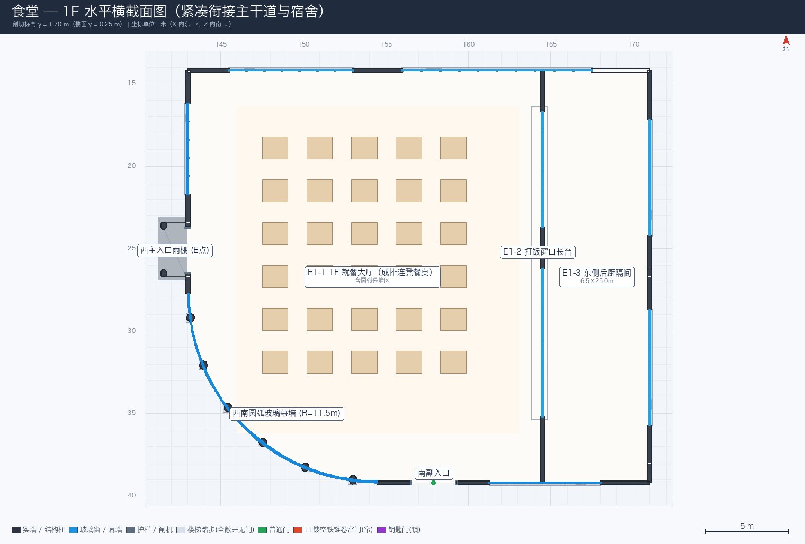

### 4.2 食堂 — 2F 横截面

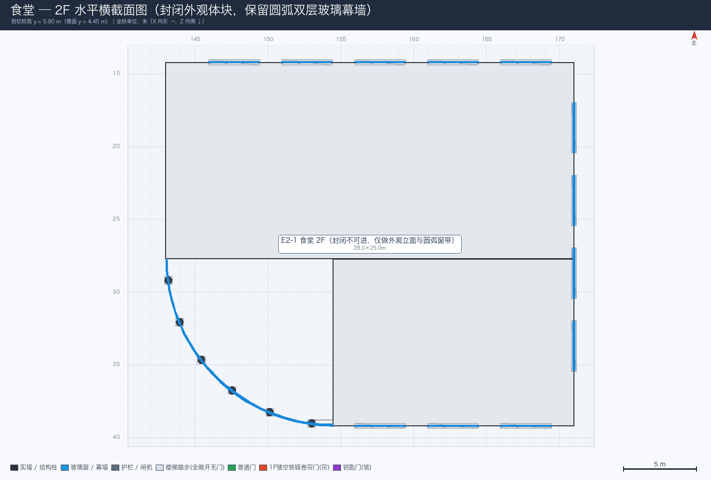

### 4.3 小卖部 — 1F 横截面

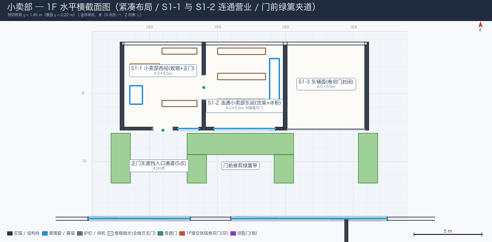

---

## 五、 南校门双保安室与刷卡闸机（`GT`）及图书馆裙楼轮廓（`LB`）

### 5.1 南校门与双保安室 — 1F 横截面

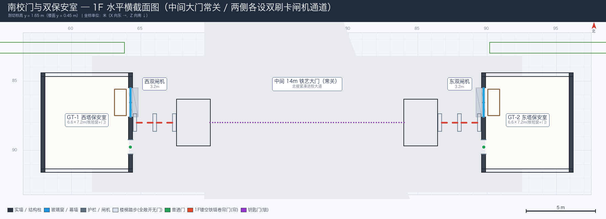

### 5.2 图书馆裙楼与正门台阶 — 1F~2F 横截面轮廓

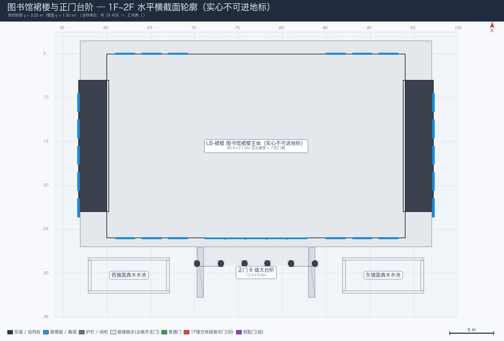
