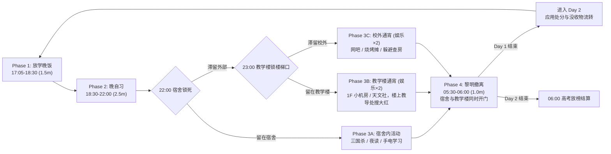
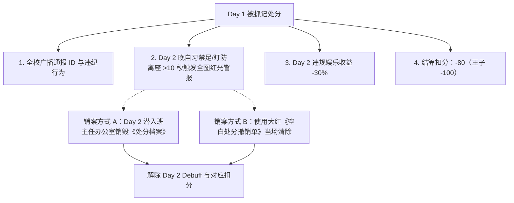

[返回总览](../GDD_策划案.md) | 下一章：[02_校园生存与后勤博弈](./02_校园生存与后勤博弈.md)

# 01. 核心循环与昼夜赛制

[TOC]

---

## 一、 两天制节奏

单局包含连续两天（Day 1、Day 2），每天 8 分钟，总计 16 分钟。Day 2 的 06:00 早自习铃响后直接进入[高考算分与结算](./06_高考算分与放榜结算.md)。

---

## 二、 每日四阶段时间轴

| 阶段 | 现实耗时 | 校园时间 | 光照与状态 | 核心行为与地图规则 |
| :--- | :--- | :--- | :--- | :--- |
| **Phase 1：放学晚饭** | 1.5 分钟 | 17:05 - 18:30 | 暖橙色夕阳 | 全图开放。[小卖部囤粮](./02_校园生存与后勤博弈.md)、宿舍打牌、翻抽屉搜[禁书](./05_传说大红与校园禁书.md)、办公室偷钥匙/假条。 |
| **Phase 2：晚自习** | 2.5 分钟 | 18:30 - 22:00 | 教室冷白光 | 教室自习/夹书看小说/趴桌回精力；[信息竞赛生](./03_阵营与角色设计.md)可合法进机房，其余角色需潜入或出校。**21:30 - 22:00 下晚自习回寝室期间，[小卖部](./02_校园生存与后勤博弈.md)开放补货**。 |
| **Phase 3：熄灯通宵** | 3.0 分钟 | 22:00 - 05:30 | 全校断电，仅手电/屏幕光源 | **外部娱乐收益 $\times 2$**。**22:00 宿舍锁死**，**23:00 教学楼锁楼梯口**（22:00~23:00 为上下楼的最后窗口）。 |
| **Phase 4：黎明撤离** | 1.0 分钟 | 05:30 - 06:00 | 天色变亮，全图监控激活 | **05:30 宿舍楼与教学楼门禁同时解除**。所有在外学生需在 06:00 前返回教室或宿舍，否则触发[撤离系数衰减](./06_高考算分与放榜结算.md)。 |

---

## 三、 跨天处分机制

学生在 Day 1 被教导阵营抓获并记处分后，不淘汰出局，而是在 Day 2 承受以下惩罚：

1. **全校广播**：抓获时触发带电流声的全图广播，播报玩家 ID 与违纪行为。若携带[实体男同/耽美小说](./05_传说大红与校园禁书.md)被抓，额外播报书名与台词，且加重处分扣分。
2. **Day 2 重点盯防**：第二天晚自习期间强制锁在座位或被班主任标记，离座超过 10 秒即触发全图红光警报。
3. **收益衰减**：背负处分期间，Day 2 所有违规娱乐收益 $-30\%$。
4. **消除方式**：
   * Day 2 潜入班主任办公室偷走并销毁自己的《处分档案》；
   * 使用传说级物品[空白处分撤销单](./05_传说大红与校园禁书.md#一-五大传说级违禁品大红)直接清除。

---

## 四、 夜间双门禁机制（22:00 宿舍 / 23:00 教学楼）

夜间实行两段式门禁，均在次日 **05:30** 统一开启：
* **22:00**：宿舍楼铁门双向锁死。
* **23:00**：教学楼**锁楼梯口**（锁楼就是锁楼梯口）：各层楼梯口双向锁死，楼上的人下不来，楼下的人上不去，没有任何办法绕开，只能等 05:30 开锁。1F 不受影响，天文社和小机房都在 1F，凭钥匙照常进出。22:00~23:00 之间还能上下楼，23:00 后楼上楼下彻底分隔。

| 23:00 后所在区域 | 空间限制 | 可执行行为 | 风险 |
| :--- | :--- | :--- | :--- |
| **宿舍楼内**（22:00 锁） | 无法外出至教学楼或校外 | 食用囤积零食、打三国杀、被窝打手电读[禁书](./05_传说大红与校园禁书.md)或学习刷基础分 | 宿管可踹门查寝；被窝光晕与洗牌声会暴露；白天藏粮可能被[抄家](./02_校园生存与后勤博弈.md) |
| **教学楼楼上**（23:00 锁楼梯口） | 下不了楼，楼下的人也上不来 | 教导处/办公室搜刮[大红物品](./05_传说大红与校园禁书.md)或偷回没收禁书 | 逃跑空间只有所在楼层；05:30 开锁前下不了楼 |
| **教学楼 1F** | 上不了楼，1F 与楼外照常走动 | 凭钥匙进天文社 / 小机房通宵（娱乐 $\times 2$） | 小机房钥匙挂在萃华楼 3F，必须 23:00 前上楼拿；老师巡逻照常经过 1F 外廊 |
| **校外**（23:00 后） | 宿舍楼与教学楼均无法进入 | 校外网吧/烧烤摊通宵（娱乐 $\times 2$） | 暴露后无室内掩体可躲；需撑到 05:30 双楼开门后顶着监控冲刺撤离（校外以后再做） |

---

[返回总览](../GDD_策划案.md) | 下一章：[02_校园生存与后勤博弈](./02_校园生存与后勤博弈.md)
