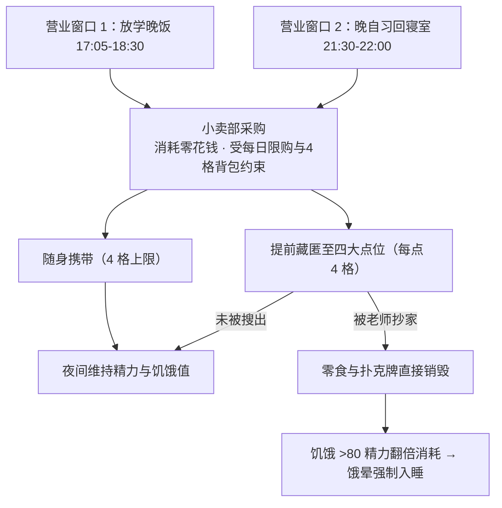

[返回总览](../GDD_策划案.md) | 上一章：[01_核心循环与昼夜赛制](./01_核心循环与昼夜赛制.md) | 下一章：[03_阵营与角色设计](./03_阵营与角色设计.md)

# 02. 校园生存、局内经济与后勤博弈

[TOC]

---

## 一、 系统目的

通过夜间精力值、饥饿值、零花钱预算、4 格随身背包与藏匿点容量，约束学生的物资筹备与夜间续航，同时为教导阵营提供“抄家断粮”的反制手段。

---

## 二、 精力值与饥饿值（夜间机制）

### 2.1 精力值（Energy，上限 100）
* **消耗**：进入 [Phase 3 熄灯通宵](./01_核心循环与昼夜赛制.md) 后持续自然下降。
* **归零后果**：角色原地趴倒睡着（屏幕变黑、发出鼾声），无法操作；若 06:00 前未被队友叫醒，判定撤离失败。
* **回复途径**：
  * 晚自习/课间在教室趴桌小睡；
  * 使用风油精 / 红牛（立即回复 50 点精力）；
  * 边吃辣条边读[禁书](./05_传说大红与校园禁书.md)可加快精力回复（噪音范围翻倍）。

### 2.2 饥饿值（Hunger，上限 100）
* **增长**：夜间活动（奔跑、翻墙、打游戏等）持续增加。
* **阈值惩罚**：
  * 饥饿值 $> 80$：精力值消耗速度翻倍；
  * 饥饿值 $= 100$：触发低血糖饿晕，原地强制入睡（05:55 后倒在教室门口触发成就[【饿死鬼投胎】](./07_成就系统与局外循环.md)）。
* **降低途径**：食用面包、泡面、辣条等零食。

---

## 三、 局内经济系统与小卖部规则

### 3.1 小卖部营业时间
小卖部在每天以下两个时段开放，**22:00 熄灯后打烊**，Day 2 重新刷新限购次数：
1. **放学晚饭时段（17:05 - 18:30）**：Phase 1 全程开放，用于跳过食堂排队并提前囤粮、藏粮。
2. **下晚自习回寝室时段（21:30 - 22:00）**：Phase 2 末段下课回寝室窗口开放，供未囤够物资的学生做熄灯前最后补货。

### 3.2 零花钱（局内货币）
* **初始与补给**：Day 1 开局每人 **20 元**；Day 2 开局自动发放当日生活费 **15 元**（未花完的余额可跨天保留）。
* **校内搜刮获取**：除固定生活费外，可在教室课桌抽屉、宿舍柜子、办公室等点位搜刮到少量散落零钱，用于突破固定预算上限。
* **主要支出**：小卖部采购、校外网吧上机费（**5 元/次**）、收买网管报信（**8 元/次**）。

### 3.3 小卖部商品价格与限购表

| 商品 | 单价 | 单格堆叠上限 | 单人每日限购 | 效果 / 副作用 |
| :--- | :---: | :---: | :---: | :--- |
| **面包** | 4 元 | 2 个 | 4 个 | 饥饿值 $-35$，进食无明显噪音 |
| **泡面** | 6 元 | 1 桶 | 2 桶 | 饥饿值 $-55$，需在宿舍或饮水机旁食用 |
| **辣条** | 5 元 | 2 包 | 3 包 | 饥饿值 $-45$、娱乐值 $+5$，咀嚼声大易暴露 |
| **风油精 / 红牛** | 8 元 | 1 个 | 2 个 | 立即回复精力值 $+50$ |
| **红蓝圆珠笔 + 空白假条** | 6 元 | 1 套 | 1 套 | 制作假请假条的耗材 |
| **降噪耳机** | 12 元 | 1 个 | 1 个 | 机房/网吧娱乐值翻倍，屏蔽全部外部声音 |

### 3.4 校内零钱与零食搜刮（提高续航上限）
除小卖部购买外，校内各容器支持搜刮少量零钱与零食，允许高活跃度玩家突破固定生活费与小卖部限购上限：

| 搜刮区域 | 零钱产出 | 零食 / 补给产出 | 交互与风险 |
| :--- | :---: | :--- | :--- |
| **教室课桌抽屉** | 1~3 元（低概率） | 散装面包、辣条 | 翻找有纸张声，易混入 AI 人群 |
| **宿舍床头 / 空衣柜** | 2~4 元（低概率） | 面包、泡面、辣条 | 宿管查寝高频区域 |
| **班级书架 / 走廊杂物柜** | 2~5 元（低概率） | 辣条、风油精 | 走廊视野开阔，易被监控或后门凝视发现 |
| **办公室 / 教导处抽屉** | 5~10 元（班费/零钱） | 被没收的零食、红牛 | 高危区域，老师高频回防，与[禁书/大红搜刮](./05_传说大红与校园禁书.md)共享点位 |

---

## 四、 背包与藏匿点容量规范

### 4.1 随身背包容量（统一 4 格）
每名学生固定拥有 **4 格**随身背包，按物品类型占格：

| 物品类别 | 占格与堆叠规则 |
| :--- | :--- |
| **小件零食**（面包、辣条） | 占 1 格，同种最多堆叠 **2 个** |
| **常规道具与禁书**（泡面、风油精/红牛、假条耗材、降噪耳机、黑板擦、各类禁书） | 每件占 **1 格**，不可堆叠 |
| **传说级大红**（押题卷、真·私章、PSP、空白处分撤销单） | 每件占 **1 格** |
| **大件大红**（铁盒《三国杀·全神将典藏》） | 占 **2 格** |
| **长柄手持物**（扫帚杆 + 饮料瓶） | **不可装入背包**，仅能手持，可随时丢弃在地面 |

### 4.2 四大物资藏匿点（每点 4 格）
超出随身 4 格的物资需提前藏匿，每个藏匿点独立提供 **4 格**存储空间（共享存取，不绑定个人）：

| 藏匿点 | 适用路线 | 特点 |
| :--- | :--- | :--- |
| 宿舍衣柜 | 宿舍通宵 | 距离寝室最近，宿管查寝时最容易搜查 |
| 机房主机箱后方 | 机房通宵 | 便于打游戏时就近补给，暴露则易被一并没收 |
| 天文社讲台下 | 天文社通宵 | 受[小赤佬](./03_阵营与角色设计.md)门禁保护，相对安全 |
| 教学楼消防栓内 | 公共游击 | 位于走廊中转处，藏放时易被路人或监控看到 |

### 4.3 老师抄家规则
* [班主任与宿管](./03_阵营与角色设计.md)巡逻时可交互检查上述四个点位。
* 搜出的**零食与扑克牌直接销毁**（单局销毁 10 份零食且致至少 1 名学生饿晕解锁成就[【抄家大队长】](./07_成就系统与局外循环.md)）。
* **注意**：被没收的[校园禁书](./05_传说大红与校园禁书.md)不会销毁，而是转存至办公室没收柜，允许学生后续偷回。

---

[返回总览](../GDD_策划案.md) | 上一章：[01_核心循环与昼夜赛制](./01_核心循环与昼夜赛制.md) | 下一章：[03_阵营与角色设计](./03_阵营与角色设计.md)
