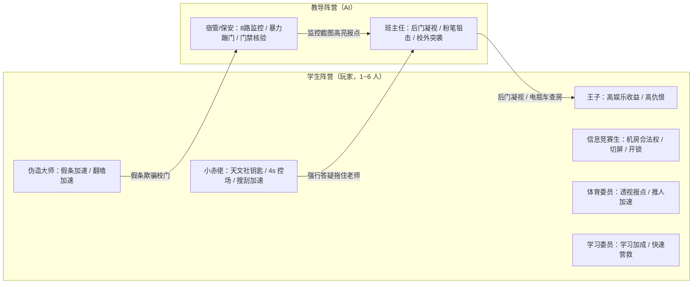

[返回总览](../GDD_策划案.md) | 上一章：[02_校园生存与后勤博弈](./02_校园生存与后勤博弈.md) | 下一章：[04_地图场景与违规交互](./04_地图场景与违规交互.md)

# 03. 阵营与角色设计（PvE）

[TOC]

---

## 一、 全员同模与 AI 混淆规则

学生玩家（当前单人，规则按最多 6 人合作设计）与地图内 15~20 名 AI 学生共用同一套校服与卡通角色模型。教导阵营由 AI 扮演，只能凭“看到的违规行为”追踪玩家，同模混淆是玩家对抗 AI 的核心手段。

* **脱战伪装**：学生脱离老师视野超过 3 秒，可坐回教室空位或混入走廊 AI 人群，按【模仿 AI】键切换为 AI 步态。
* **误抓**：AI 老师追丢目标后可能盘问附近的 AI 学生，误抓时触发 **2.5 秒**愧疚硬直，玩家可借机脱身（高难度下 AI 误抓概率降低）。
* **例外限制**：手持[空白处分撤销单](./05_传说大红与校园禁书.md)时无法使用一键伪装，需先放进背包或柜子。

---

## 二、 学生阵营（6 名角色）

### 1. 王子（高收益 / 高风险娱乐位）
* **背景**：前科多、受老师重点关注，但理科大考成绩突出。
* **被动【纯粹的快乐】**：所有违规娱乐行为获得的娱乐值 $+40\%$。
* **被动【眼中钉】**：老师发现他时警觉条涨速翻倍；被抓后罚站/禁足时间延长，处分扣分升至 **100**（默认 80），且没收身上全部零食。
* **负面机制【天然呆犯错】**：在暗处（半夜机房、天文社等）娱乐时定期触发短 QTE；失败则发生失误（如在机房误开大灯或发出声音），暴露全屋位置（关联成就[【天然呆本呆】](./07_成就系统与局外循环.md)）。

### 2. 信息竞赛生（机房位）
* **被动【合法上班】**：唯一允许在晚自习合法进入小机房（竞赛生的机房，萃华楼 1F 圆厅）的角色；前往机房途中老师警惕度大幅降低。
* **被动【极速切屏】**：机房切屏 QTE 判定区间 $+100\%$，可提前 2 秒隔门听到门外脚步声与敲门声。
* **主动【门锁专家】**：使用[扫帚杆+饮料瓶](./04_地图场景与违规交互.md#二-机房进入的三种方式)开锁时稳定性提升，不易掉落。

### 3. 小赤佬（资源 / 控制位）
* **背景**：天文社社长，掌握隐蔽资源，擅长拖延老师。
* **主动【强行答疑】**：靠近老师触发，缠住老师持续 **4 秒**。期间老师无法攻击、无法移动、视角锁定在小赤佬身上。可用于办公室偷物资/反偷[没收禁书](./05_传说大红与校园禁书.md)或掩护队友带大红撤离（关联成就[【话术大师】](./07_成就系统与局外循环.md)）。
* **主动【天文社权限】**：开局自带天文社钥匙（内有 2 台电脑），可将备用钥匙分配给队友。
* **被动【顺手牵羊】**：在办公室翻找假条、印章、考试卷、没收柜物品的速度 $+50\%$。偷出“考试卷”分享可提升全队基础知识值。

### 4. 伪造大师（校外突围位）
* **主动【神笔马良】**：制作假请假条耗时 $-50\%$，假条逼真度基础值 $+30\%$。
* **被动【翻墙好手】**：翻越围墙、网吧后门窗户及障碍物速度 $+40\%$。

### 5. 体育委员（侦察 / 脱身位）
* **主动【敌情暗号】**：吹口哨使 30 米内队友透视班主任位置 **4 秒**。
* **被动【塑料友情】**：被追击时可消耗体力推开身旁的学生（队友或 AI），自身获得 **2 秒**加速，被推者短暂踉跄（关联成就[【塑料友情】](./07_成就系统与局外循环.md)）。

### 6. 学习委员（保底 / 救援位）
* **被动【自律达人】**：晚自习写作业、宿舍打手电学习获得的基础知识值 $+35\%$。
* **主动【帮写检讨】**：解救罚站柱上的队友时速度翻倍。

---

## 三、 教导阵营 AI（2 名）

> PvE 下以下技能全部转为 **AI 行为**：触发条件、冷却与命中率由难度配置（`DifficultyDef`）控制，具体的感知 / 决策 / 协同设计见下方第四节。

### 1. 班主任（抓捕 / 校内外机动）
* **主动【后门凝视】**：靠近教室/机房门窗进入隐匿状态，透视玻璃高亮室内所有违规学生，可识破夹在课本里的漫画（关联成就[【后门死神】](./07_成就系统与局外循环.md)）。
* **主动【粉笔头狙击】**：中距离投掷，命中造成 **1.5 秒**僵直并触发 Ragdoll。
* **主动【教鞭制裁】**：近战击倒学生，可拎起绑在罚站柱或押送至教导处记处分（中途队友可营救）。
* **主动【校外突击巡查】**：长冷却；骑电瓶车前往校外网吧和烧烤摊查房，期间校内防守空虚。

### 2. 宿管 / 保安大爷（监控 / 控场 / 门禁）
* **主动【天眼监控】**：切入监控室，在全校 8 个摄像头间切换。拍到熄灯后在外的学生可点击【截图发年级群】，向全图弹出群消息提示并向班主任高亮目标位置 **10 秒**（关联成就[【天眼制裁】](./07_成就系统与局外循环.md)）。
* **主动【暴力踹门】**：强行破开反锁的宿舍门或社团门，眩晕门后 3 米内学生 **2 秒**。
* **被动【门禁与核验】**：负责 22:00 锁死宿舍大门、23:00 锁死教学楼各层楼梯口（次日 05:30 统一开启）；在校门核验请假条，识破假条即拉响全校警报（[真·私章](./05_传说大红与校园禁书.md)制作的假条必定通过）。

---

## 四、 PvE AI 设计要点（v3.1，实现计划见开发路线）

| 维度 | 设计 |
| :--- | :--- |
| **感知** | 视觉：视锥 + 遮挡 + 光照（熄灯后视距缩短，玩家开手电 / 开灯会被远距离发现）；听觉：脚步、奔跑、辣条咀嚼、扫帚杆刮擦、机房开灯等**噪声事件**，按音量与距离传播。 |
| **记忆与警觉** | 每名 AI 维护对可疑目标的警觉值与最后已知位置；警觉随违规程度、距离、角色（王子仇恨翻倍）上涨，脱离视线后衰减。 |
| **决策** | 巡逻 → 起疑（停下凝视）→ 调查噪声源 → 追捕 → 搜索（最后已知位置附近）→ 回报 / 回到巡逻。 |
| **协同** | 宿管监控“截图发年级群”时把目标位置共享给班主任；高难度下两名 AI 会包抄、守出口、熄灯后抄家。 |
| **难度分级** | 简单 / 普通 / 困难 / 噩梦：调节感知距离、反应时间、搜索时长、是否预判逃跑方向、是否主动抄家与蹲守。 |

---

[返回总览](../GDD_策划案.md) | 上一章：[02_校园生存与后勤博弈](./02_校园生存与后勤博弈.md) | 下一章：[04_地图场景与违规交互](./04_地图场景与违规交互.md)
