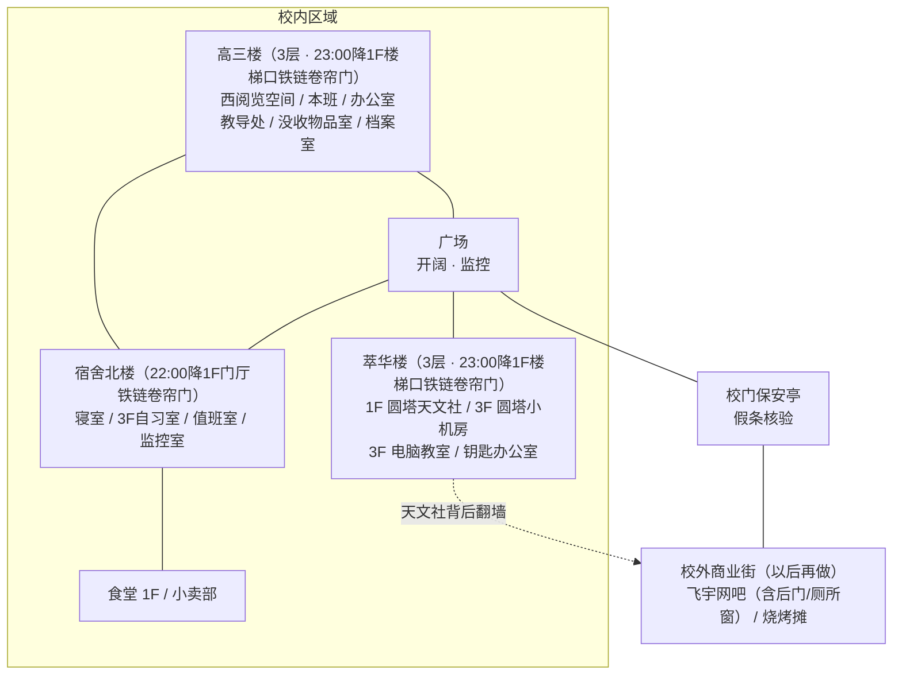

[返回总览](../GDD_策划案.md) | 上一章：[03_阵营与角色设计](./03_阵营与角色设计.md) | 下一章：[05_传说大红与校园禁书](./05_传说大红与校园禁书.md)

# 04. 地图场景与违规交互

[TOC]

---

## 一、 地图空间结构

校内紧凑编排成三排（布局、尺寸和各楼开间表见 [04_地图场景编辑计划](../production/04_地图场景编辑计划.md)），每栋楼都有两部楼梯和外廊，确保追逐绕点与多路径转点：

* **北东生活区**：宿舍北楼（可进，1F 围合门厅 L 梯直上 2F，南北主梯通往 1F 监控室/值班室与 3F 自习室）、宿舍南楼（远景）、食堂（只开 1F）、食堂北侧的小卖部（两间连通）。
* **中北地标区**：树林、图书馆及馆前对称水景（地标，不可进）。
* **南教学与运动区**：萃华楼（圆塔 1F 南半整间为天文社、3F 中段为小机房，主楼 3F 为电脑教室与钥匙办公室）、中心广场、高三楼（西端阅览空间、本班教室、办公室、教导处）、西南操场。

校外商业街（飞宇网吧、老王烧烤摊）在校门外，等校内跑通后再做。

---

## 二、 机房进入的三种方式

萃华楼 3F 主楼的大电脑教室是上课用的，不锁，但晚上没课，进去开机肯定被发现。**晚上能玩电脑的只有 3F 圆塔中段的小机房**（竞赛生的机房）。除[信息竞赛生](./03_阵营与角色设计.md)晚自习可合法进入外，小机房默认上锁，需通过以下方式潜入：

1. **办公室取钥匙**：钥匙串挂在萃华楼 3F 东侧的钥匙办公室里（有小机房和各间教室的钥匙）。这间办公室朝外廊没有门，只能从 3F 电脑教室东墙南端的内门进去；2F/3F 楼梯全敞开无门，但 **23:00 教学楼 1F 各楼梯口的镂空铁链卷帘门降下锁死**，所以要在 23:00 前上到 3F 拿钥匙或进入 3F。办公室可能有老师停留（需配合[小赤佬](./03_阵营与角色设计.md)的【强行答疑】掩护）。
2. **蹭老学长开门（动态事件）**：局内随机刷新持钥匙的“老学长 NPC”前往机房，紧跟其后即可蹭门进入。
3. **扫帚杆 + 饮料瓶物理开锁**：
   * 小机房门在 3F 西门厅圆塔东墙中段，附近角落固定刷新套着塑料饮料瓶的扫帚杆。
   * 站在门外将杆子从门上方防盗网格伸入，进入第一人称物理微操小游戏，控制角度与力度按压门内侧门把手开门。
   * **风险**：操作时持续发出摩擦声；偏离过大导致杆子掉落会发出巨响，吸引同楼层老师。
   * **成就联动**：8 秒内无失误开门解锁[【物理开锁大师】](./07_成就系统与局外循环.md)。

---

## 三、 主要场景违规交互

| 场景 | 操作与收益机制 | 风险与反制规则 |
| :--- | :--- | :--- |
| **小机房打游戏** | 启动电脑持续获取娱乐值。可开启**戴耳机模式**，收益翻倍但屏蔽一切外部脚步声与开门声。 | 发现老师时需完成 **Alt+Tab 切屏 QTE**，失败即被抓；王子有概率误触开大灯。 |
| **寝室打三国杀** | 放学或熄灯后 2~4 人开局，人数越多收益越快。持有大红[铁盒三国杀](./05_传说大红与校园禁书.md)时全桌翻倍且无洗牌噪音。 | 宿管踹门时触发 **2 秒藏牌 QTE**；来不及可将牌塞入室友衣柜嫁祸。 |
| **天文社通宵** | 凭[小赤佬](./03_阵营与角色设计.md)钥匙进入萃华楼 1F 圆塔南半整间（平时拉着帘子，北半封闭），使用 2 台电脑看小说/上网。天文社在 1F，23:00 降下 1F 楼梯口铁链卷帘门后照样能从 1F 门厅进入。**不可开灯**（开灯直接暴露）。 | 需留意[饥饿值与精力值](./02_校园生存与后勤博弈.md)，防止双双睡过头错过 05:30~06:00 撤离。 |
| **假请假条与网吧** | 1. 办公室偷假条 → 仿造签名小游戏 → 过校门保安（持有[真·私章](./05_传说大红与校园禁书.md)则免 QTE 必过）。 2. 网吧内玩街机/MOBA 补刀小游戏，操作评分越高，娱乐值倍率越高。 | 班主任可骑电瓶车突袭查房；学生可花零花钱**收买网管报信**，收到提示后有 3 秒从后门/厕所窗翻出逃回学校（关联成就[【网吧战神】](./07_成就系统与局外循环.md)）。 |
| **教室自习 / 摸鱼** | 晚自习可选择认真写题（加基础知识值）、趴桌回精力，或夹书偷看[校园禁书](./05_传说大红与校园禁书.md)。 | 摸鱼时可能被老师随机点名提问（屏幕模糊 + 答题），答错拎出罚站。 |

---

[返回总览](../GDD_策划案.md) | 上一章：[03_阵营与角色设计](./03_阵营与角色设计.md) | 下一章：[05_传说大红与校园禁书](./05_传说大红与校园禁书.md)
