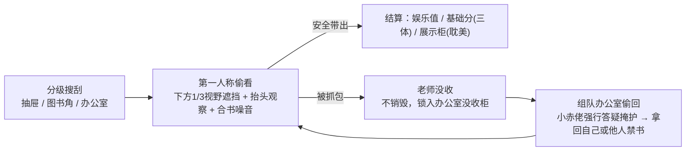

[返回总览](../GDD_策划案.md) | 上一章：[04_地图场景与违规交互](./04_地图场景与违规交互.md) | 下一章：[06_高考算分与放榜结算](./06_高考算分与放榜结算.md)

# 05. 传说级违禁品（大红）、校园禁书与道具系统

[TOC]

---

## 一、 五大传说级违禁品（大红）

在**教导处保险柜、没收物品室、班主任办公桌抽屉、天文社暗格、网吧吧台**搜刮时，有极低概率产出传说级违禁品（触发金红光效与专属音效，如变调进行曲或心跳重音）。

| 物品名称 | 刷新地点 | 局内效果与结算价值 | 携带风险 / 限制 |
| :--- | :--- | :--- | :--- |
| **1. 绝密·高考命题组押题卷** | 教导处保险柜 / 校长室 | 成功撤离至 Day 2 早自习，直接保底 **$+200$ 基础知识分**。 | 移速 $-10\%$；被老师抓到直接全校通缉，无法用学霸免死金牌抵消。 |
| **2. 教导主任的“真·私章”** | 班主任 / 教导处办公桌 | 制作假请假条无需 QTE、**100% 通过保安核验**；带出折算高额[学分币](./07_成就系统与局外循环.md)并可入柜展示。 | 失窃 **30 秒后**教导阵营收到全图提示“主任印章失窃”，全图老师进入狂暴搜查状态。 |
| **3. 绝版神装 PSP / 初代 iPhone** | 教导处没收物品柜 | 可随时掏出游玩，**娱乐值涨速 $\times 3$**（全图最高）；带出后永久陈列在[大厅展示柜](./07_成就系统与局外循环.md)。 | 熄灯后屏幕光照范围极大，隔两条走廊即可被宿管发现。 |
| **4. 绝版铁盒《三国杀·全神将典藏》** | 宿管值班室暗格 / 宿舍楼顶 | 宿舍开局打牌时**全桌娱乐值翻倍**，且消除洗牌噪音；带出结算价值高。 | 占用 **2 个道具栏**；奔跑时发出轻微铁盒碰撞声。 |
| **5. 空白处分撤销单** | 档案室 / 校长抽屉 | 可当场撕毁 Day 1 的[处分记录](./01_核心循环与昼夜赛制.md#三-跨天处分机制)；若保留未使用直接带出，结算触发全校通报表扬，**额外 $+100$ 高考分**。 | 手持状态下**禁用“一键伪装”**，需先放入背包或柜子。 |

---

## 二、 校园禁书搜刮与阅读系统

### 2.1 搜刮容器分级

| 搜刮点位 | 危险等级 | 交互特征 | 产出范围 |
| :--- | :---: | :--- | :--- |
| **教室课桌抽屉** | 低 | 翻找发出纸张声；有概率摸出空草稿纸 | 言情口袋书、漫画杂志、散装打印网文、**少量零钱（1~3 元）与散装零食** |
| **班级后排书架 / 图书角** | 中 | 视野开阔易被后门凝视；需翻找暗格或辨认包着《五三》书皮的伪装书 | 《龙族》《三体》、热门 CP 同人手抄本、**少量零钱（2~5 元）与辣条/风油精** |
| **班主任 / 教导处办公室** | 极高 | 位于没收物品柜/办公桌抽屉；实时存放本局其他玩家被没收的书 | 无删减实体男同/耽美小说、绝版同人志、被没收的高级书、**零钱（5~10 元）与被没收的零食/红牛** |

### 2.2 禁书图鉴与机制

| 类型 / 代表 | 品质 | 核心收益 | 专属机制与负面效果 |
| :--- | :---: | :--- | :--- |
| **言情口袋书**（如《霸道总裁爱上我》） | 普通（绿） | 稳定娱乐值 | **【姨母笑检定】**：高甜桥段触发轻量 QTE，失败发出怪笑，吸引 5 米内老师。 |
| **漫画 / 杂志**（如《知音漫客》） | 普通（绿） | 中等娱乐值 | **【极速伪装】**：可夹在《五三》课本内阅读；正面经过无法识破，但会被[【后门凝视】](./03_阵营与角色设计.md)看穿。 |
| **硬核科幻**（如《三体》） | 稀有（蓝） | 中等娱乐值 + 少量基础知识值 | **【降维打击】**：被抓包时老师先硬直 **1.5 秒**，为玩家争取逃跑时间。 |
| **青春幻想**（如《龙族》） | 稀有（紫） | 极高娱乐值 | **【中二之魂】**：读满一段获得 15 秒移速 $+15\%$；读到虐心章节会发出抽泣/叹气声暴露位置。 |
| **热门同人小说**（手抄本 / 同人志） | 稀有（紫） | 高娱乐值 | **【双人磕 CP】**：可与同桌/室友共享阅读，娱乐值翻倍；但两人同时处于视野遮挡状态。 |
| **实体男同 / 耽美小说**（厚重封面伪装） | **传说（大红）** | **娱乐值倍率 $\times 2.5$** + 带出进[展示柜](./07_成就系统与局外循环.md) | **【精神冲击】**：被老师没收并翻开第一页瞬间，老师触发 **2 秒**硬直，玩家可趁机逃跑。 **【广播处刑】**：带此书被抓进教导处时，全校广播播报书名并朗读台词，**处分扣分额外加重**（解锁[【当众处刑】](./07_成就系统与局外循环.md)）。 |

---

## 三、 禁书与核心系统联动

1. **没收—办公室流转—偷回闭环**：老师抓获学生看书后不销毁书本，而是带回办公室锁进没收柜。Day 1 被没收的书在 Day 2 仍存于柜中，玩家可组队（配合[小赤佬](./03_阵营与角色设计.md)）潜入办公室偷回自己或他人被没收的禁书（关联成就[【办公室零元购】](./07_成就系统与局外循环.md)）。
2. **第一人称偷看操作**：
   * 翻书后书本遮挡屏幕下方 1/3 视野，需主动按键抬头观察走廊与后门；
   * 按伪装键收书较快，但会发出合书声，门外潜行老师可听见。
3. **与生存/门禁联动**：
   * 边吃辣条边看书可叠加娱乐值并加快精力回复，但噪音范围翻倍；
   * 22:00 门禁后可在宿舍被窝打小手电夜读，被窝会透出光晕，宿管巡逻时需及时关灯装睡。
4. **与算分/成就联动**：《三体》可兼顾基础分；同人/耽美属纯高危娱乐流。配套新增[三项禁书专属成就](./07_成就系统与局外循环.md#四-校园禁书成就)。

---

## 四、 常规功能道具

具体营业时段、零花钱预算、校内搜刮产出及每日限购详见[02_校园生存与后勤博弈](./02_校园生存与后勤博弈.md#三-局内经济系统与小卖部规则)。

| 道具 | 获取途径 / 单价 | 占格与堆叠 | 功能与副作用 |
| :--- | :--- | :---: | :--- |
| **面包 / 泡面 / 辣条** | 小卖部（4 / 6 / 5 元）或校内容器搜刮 | 面包、辣条 1 格堆叠 2；泡面 1 格 | 降低[饥饿值](./02_校园生存与后勤博弈.md)。辣条咀嚼声大易暴露；泡面需在宿舍/饮水机旁食用。 |
| **风油精 / 红牛** | 小卖部（8 元）或书架/办公室搜刮 | 1 格 | 立即回复 **50 点精力值**。 |
| **降噪耳机** | 地图刷新 / 小卖部（12 元） | 1 格 | 机房/网吧使用，娱乐值翻倍，但屏蔽一切外部声音。 |
| **红蓝圆珠笔 + 空白假条** | 办公室 / 小卖部（6 元） | 1 格 | 制作假请假条的耗材。 |
| **扫帚杆 + 饮料瓶** | 机房附近固定刷新 | 仅限手持（不可入包） | 用于机房门上方网格[物理开锁](./04_地图场景与违规交互.md#二-机房进入的三种方式)。 |
| **黑板擦陷阱** | 教室讲台 | 1 格 | 放置于门框顶部，班主任推门时掉落造成 **2 秒**致盲。 |

---

[返回总览](../GDD_策划案.md) | 上一章：[04_地图场景与违规交互](./04_地图场景与违规交互.md) | 下一章：[06_高考算分与放榜结算](./06_高考算分与放榜结算.md)
