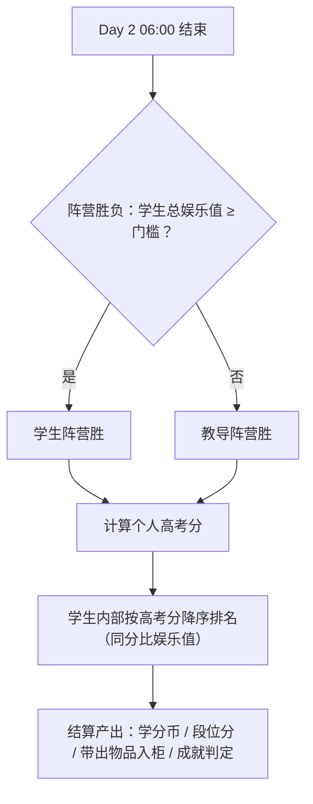

[返回总览](../GDD_策划案.md) | 上一章：[05_传说大红与校园禁书](./05_传说大红与校园禁书.md) | 下一章：[07_成就系统与局外循环](./07_成就系统与局外循环.md)

# 06. 高考算分与放榜结算

[TOC]

---

## 一、 结算流程

Day 2 的 06:00 早自习铃响后，全员切入“高考成绩查询”界面，依次结算阵营胜负、个人高考分及局外奖励。

---

## 二、 阵营胜负与排名规则（v2.1）

* **阵营胜负**：统计全体学生玩家的**娱乐值总和**（不含 AI）。
  * 总和 $\geq$ 门槛（单人门槛 $\times$ 学生人数）$\rightarrow$ **学生阵营胜**；
  * 否则 $\rightarrow$ **教导阵营胜**。
  * 单人门槛暂定 `250`，进入数值配置表（见 [开发任务拆分](../production/01_开发任务拆分.md) ST 模块）。
* **学生内部排名**：按最终高考分从高到低排序；同分时娱乐值高者靠前。
* **设计目的**：娱乐值决定团队胜负并拉高个人上限；纯学习路线个人分数稳定，但对团队娱乐门槛贡献为 0，在团队目标与个人排名间形成冲突。

---

## 三、 双轨制算分公式

$$\text{最终高考分} = \min\Big(750,\ \text{基础知识值} + \text{娱乐值} \times \text{撤离系数} \times \text{心态转化率} + \text{大红加分} - \text{处分扣分}\Big)$$

| 参数 | 规则说明 |
| :--- | :--- |
| **基础知识值**（常规上限 580） | 初始 200 分。通过教室自习、宿舍打手电学习、读[《三体》](./05_传说大红与校园禁书.md)或共享[小赤佬](./03_阵营与角色设计.md)偷来的考试卷提升。纯学习路线可达 550~580 分。 |
| **娱乐值与心态转化率** | 来源于各类违规娱乐、网吧小游戏、禁书与 PSP。基础心态转化率为 $1.0$（[王子](./03_阵营与角色设计.md)娱乐值获取 $+40\%$）。 |
| **撤离系数** | 两天均在 06:00 前撤回教室/宿舍为 **$1.0$**；一天未归降至 **$0.7$**；两天未归降至 **$0.5$**。 |
| **大红加分**（v3.0） | 带出[绝密·高考命题组押题卷](./05_传说大红与校园禁书.md)保底 **$+200$ 基础知识分**；带出未使用的[空白处分撤销单](./05_传说大红与校园禁书.md)触发全校通报表扬，额外 **$+100$ 高考分**。 |
| **处分扣分** | 每次未消除的处分扣除 **$80$ 分**（王子扣除 **$100$ 分**）；携带[实体男同/耽美小说](./05_传说大红与校园禁书.md)被抓时额外加重扣分。 |

---

## 四、 放榜评级与评语

结算页支持一键生成成绩单截图分享，并展示玩家的[自定义喜报边框与称号](./07_成就系统与局外循环.md)。

| 分数段 | 评级称号 | 评语 |
| :--- | :--- | :--- |
| $< 400$ | 【大专预警·纪律反面教材】 | “玩又没玩明白，跑又跑不过宿管，明年复读吧。” |
| $400 \sim 549$ | 【普通本科·老实人】 | “天天乖乖写作业，结果考得不如网吧战神。” |
| $550 \sim 649$ | 【985 预备·时间管理大师】 | “一手三国杀一手五年高考，你小子是懂劳逸结合的。” |
| $650 \sim 684$ | 【清北之姿·校园幽灵】 | “全校监控拍不到你，高考也难不倒你。” |
| $685 \sim 750$ | 【全校第一·传奇耐抓王】 | “处分是三月吃的，校一是六月考的！”（触发全屏金光与班级群刷屏特效） |

---

[返回总览](../GDD_策划案.md) | 上一章：[05_传说大红与校园禁书](./05_传说大红与校园禁书.md) | 下一章：[07_成就系统与局外循环](./07_成就系统与局外循环.md)
