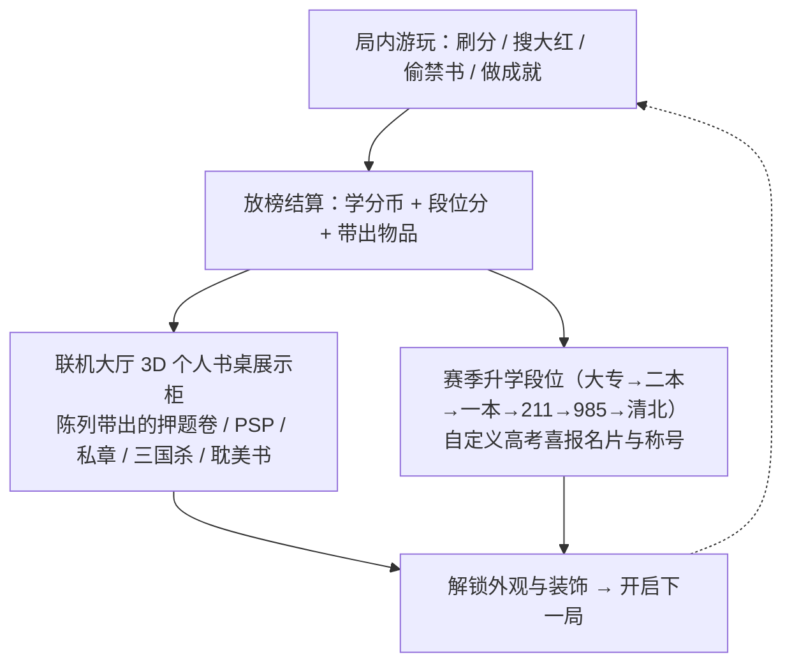

[返回总览](../GDD_策划案.md) | 上一章：[06_高考算分与放榜结算](./06_高考算分与放榜结算.md) | 下一章：[08_视听规范与开发路线](./08_视听规范与开发路线.md)

# 07. 成就系统与局外循环（Meta Loop）

[TOC]

---

## 一、 局外循环结构

单局结算后，收益汇入收藏展示、段位晋升与外观解锁三个局外模块：

### 三大局外模块需求

1. **联机大厅个人书桌 / 展示柜**：
   * 组队等待界面为 **3D Low-Poly 宿舍/教室大厅**，而非纯 2D UI。
   * 每名玩家拥有独立课桌与铁皮柜，局内成功带出的传说级违禁品（押题卷、PSP、私章、铁盒三国杀、绝版耽美小说）会以 3D 实体形式摆放在桌上，房间内其他玩家可直接查看。
2. **“高考喜报”自定义名片**：
   * 完成成就可解锁喜报边框与动态称号（如 `【传奇耐抓王】`、`【清北在逃犯】`、`【当众处刑者】`），在结算放榜界面向全房间 8 人展示。
3. **赛季升学段位**：
   * 段位梯度：**大专 → 二本 → 一本 → 211 → 985 → 清北**。
   * 按每局高考分累计升学段位分，作为不依赖“摸大红”运气的稳定长期目标。

---

## 二、 成就系统

成就分为四大类，用于引导玩家尝试高难操作、整活玩法、教导控场及禁书交互。

### 1. 传奇事迹类

| 成就名 | 解锁条件 | 关联模块 |
| :--- | :--- | :--- |
| 【处分是三月吃的，校一是六月考的】 | Day 1 吃过至少 1 次处分，Day 2 结算考出 **685 分以上**且获全校第一。 | [跨天处分](./01_核心循环与昼夜赛制.md)、[放榜结算](./06_高考算分与放榜结算.md) |
| 【物理开锁大师】 | 使用“扫帚杆 + 饮料瓶”在 **8 秒内**无失误打开机房门。 | [机房潜入](./04_地图场景与违规交互.md) |
| 【网吧战神】 | 网吧小游戏打出最高评级，并在班主任骑电瓶车查房时从后门逃生回校。 | [网吧博弈](./04_地图场景与违规交互.md) |
| 【头悬梁锥刺股】 | 整局娱乐值为 0，纯靠自习与宿舍手电学习考出 600 分以上。 | [双轨算分](./06_高考算分与放榜结算.md) |

### 2. 抽象整活类

| 成就名 | 解锁条件 | 关联模块 |
| :--- | :--- | :--- |
| 【天然呆本呆】 | 使用[王子](./03_阵营与角色设计.md)在凌晨 2 点后的机房误开大灯，并在 10 秒内被班主任抓获。 | [角色被动](./03_阵营与角色设计.md) |
| 【塑料友情】 | 被追击时推开队友致其被抓，自身成功混入 AI 人群脱身。 | [体育委员](./03_阵营与角色设计.md) |
| 【饿死鬼投胎】 | 在 05:55 天亮撤离最后 5 秒内，因[饥饿值](./02_校园生存与后勤博弈.md)满倒在教室门口睡着。 | [生存系统](./02_校园生存与后勤博弈.md) |
| 【话术大师】 | 使用[小赤佬](./03_阵营与角色设计.md)单局累计【强行答疑】缠住老师超过 20 秒且自身未被抓。 | [强行答疑](./03_阵营与角色设计.md) |

### 3. 教导阵营专属成就

| 成就名 | 解锁条件 | 关联模块 |
| :--- | :--- | :--- |
| 【后门死神】 | 单局通过【后门凝视】累计发现 5 名以上违规学生。 | [班主任](./03_阵营与角色设计.md) |
| 【抄家大队长】 | 单局搜出并销毁 10 份学生藏匿的零食，且导致至少 1 名学生半夜饿晕。 | [抄家机制](./02_校园生存与后勤博弈.md) |
| 【天眼制裁】 | 监控室截图发年级群后，配合班主任在 15 秒内完成抓捕。 | [宿管/保安](./03_阵营与角色设计.md) |

### 4. 校园禁书成就

| 成就名 | 解锁条件 | 关联模块 |
| :--- | :--- | :--- |
| 【当众处刑】 | 携带[实体男同/耽美小说](./05_传说大红与校园禁书.md)被抓，触发全校广播朗读台词。 | [禁书图鉴](./05_传说大红与校园禁书.md) |
| 【五三战神】 | 使用夹在《五三》里的漫画/小说，在班主任视野内累计阅读满 60 秒未被发现。 | [偷看操作](./05_传说大红与校园禁书.md) |
| 【办公室零元购】 | 从班主任没收柜偷回 3 本以上被没收的禁书并成功带出至天亮。 | [没收反偷闭环](./05_传说大红与校园禁书.md) |

---

## 三、 学分币与外观解锁（无数值加成）

每局高考分及部分带出的大红物品按比例折算为**学分币**，仅用于解锁装饰项：

* **校服皮肤**：肥大蓝白运动校服、冬季厚羽绒服、披肩外套。
* **脸部表情贴图**：自定义 2D 像素/表情包贴图（墨镜、流汗、睡眼、惊恐猫脸等）。
* **喜报边框**：红底金字喜报框、德育处红头文件处分框、录取通知书金框。
* **书桌摆件**：大厅个人书桌装饰（《五三》题库堆、诺基亚、老式台灯等）。

---

[返回总览](../GDD_策划案.md) | 上一章：[06_高考算分与放榜结算](./06_高考算分与放榜结算.md) | 下一章：[08_视听规范与开发路线](./08_视听规范与开发路线.md)
