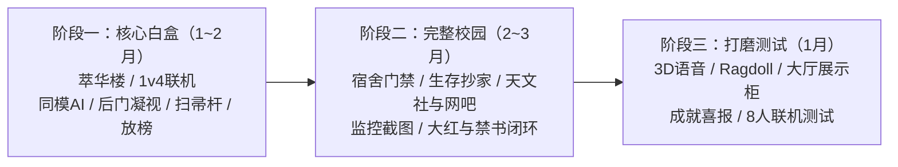

[返回总览](../GDD_策划案.md) | 上一章：[07_成就系统与局外循环](./07_成就系统与局外循环.md)

# 08. 视听规范、商业化与 MVP 开发路线

[TOC]

---

## 一、 3D 视听规范

### 1.1 美术与光影
* **风格**：3D 卡通。角色为 Q 版大头造型（头身比约 1:3.5~1:4），道具与场景是简化写实的中式校园物件；贴图以平涂色块为主，配一张 AO 贴图出体积感，不画法线细节；光照明亮柔和。
* **模型面数**：学生约 1~1.5 万三角面（另做 LOD），老师约 1~1.2 万；家具 300~1800；具体规格见 [02 美术资源清单 1.1](../production/02_美术资源清单.md)。地图同屏 15~20 名 AI 学生，靠 LOD 控制总面数。
* **昼夜光照**：
  * **傍晚/白天（Phase 1）**：暖色烘焙光照。
  * **熄灯通宵（Phase 3）**：环境光骤降，仅保留月光、电脑屏幕光、宿舍被窝手电光、大红 PSP 强光及老师手电筒体积光。
* **物理布娃娃（Ragdoll）**：被粉笔头击中、被拎起、翻墙摔落或被队友推开时切换 Ragdoll 物理状态。

### 1.2 音效与语音
* **近距离 3D 语音（Proximity Voice Chat）**：玩家语音随距离衰减，PvE 下语音仅用于合作模式队友之间；AI 老师不监听语音，只对游戏内噪声事件做出反应。
* **核心功能音效**：
  * 预警类：走廊皮鞋声、钥匙串声、踹门声；
  * 行为暴露类：塑料瓶刮擦防盗网声、辣条咀嚼声、合书声、铁盒碰撞声；
  * 全局事件类：全校广播电流声与处分播报、摸出[大红物品](./05_传说大红与校园禁书.md)的专属音效（变调进行曲 / 心跳重音）。

---

## 二、 商业化方案

* **定价模式**：Steam 买断制，定价 **22~28 元**（首发折后约 18 元）。
* **后续更新**：免费更新平衡性、新角色与新物品；付费 DLC 提供新地图（如考场篇、军训基地篇）与外观包。

---

## 三、 MVP 三阶段开发路线

1. **阶段一：核心玩法白盒验证（1~2 个月）**
   * 搭建萃华楼（教室 + 外廊 + 办公室 + 3F 机房，见 [04_地图场景编辑计划](../production/04_地图场景编辑计划.md)），跑通 1v4 联机框架。
   * 验证 4 项核心机制：全员同模混淆 AI、班主任后门凝视、机房扫帚杆开锁 + 戴耳机切屏 QTE、高考放榜结算界面。
2. **阶段二：两天制与完整校园扩充（2~3 个月）**
   * 加入宿舍楼（22:00 双向门禁、三国杀、抄家）、小卖部与精力/饥饿系统、天文社与小赤佬【强行答疑】、假请假条与网吧/电瓶车突袭。
   * 接入宿管监控室【截图发年级群】。
   * 实装[五大传说级违禁品](./05_传说大红与校园禁书.md)与校园禁书搜刮—没收—办公室偷回闭环。
3. **阶段三：体验打磨与宣发测试（1 个月）**
   * 接入近距离 3D 语音与 Ragdoll 优化。
   * 完成联机大厅 3D 个人书桌展示柜、四大类成就系统、赛季升学段位与成绩单截图分享。
   * 开展 8 人联机内测。

---

[返回总览](../GDD_策划案.md) | 上一章：[07_成就系统与局外循环](./07_成就系统与局外循环.md)
